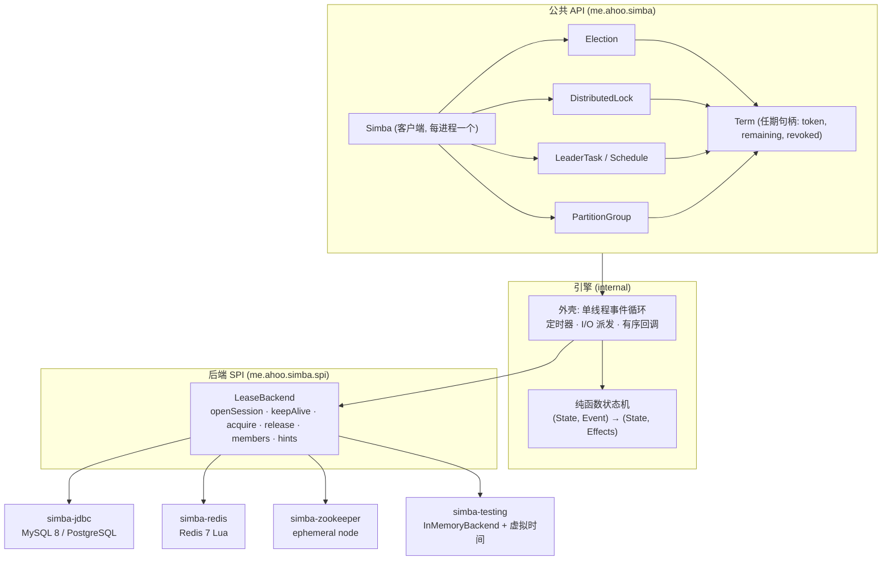
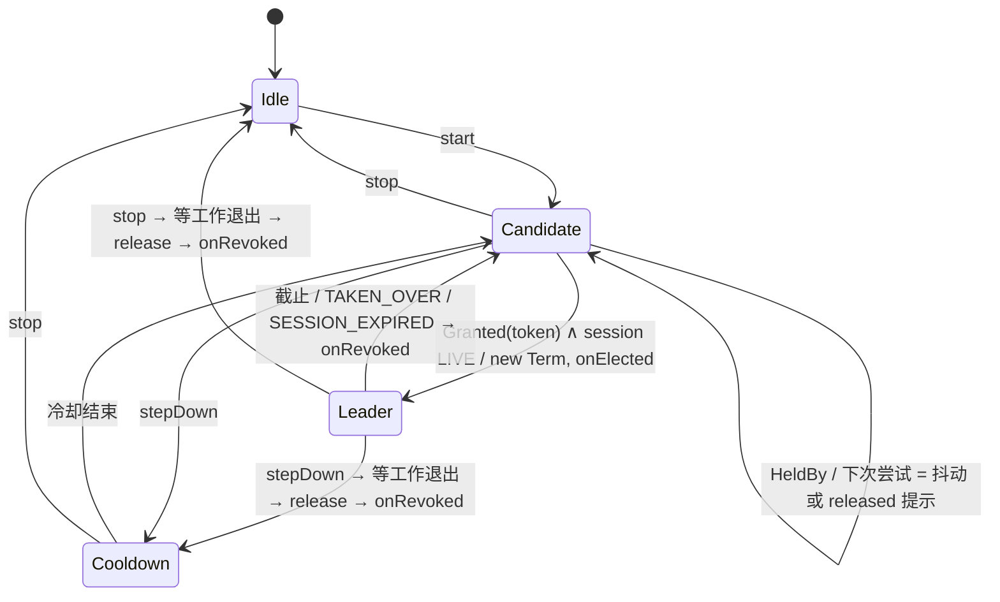

# ADR 0010: Simba 5 目标架构 —— 会话租约 · 任期句柄 · 纯函数状态机

- Status: Accepted — 权衡取舍(§14:Java 21 基线、放弃 FIFO 公平、放弃推送他人 owner)已于 2026-10-18 确认;按 §15 分阶段实施
- Date: 2026-10-18
- 范围: 完全重构,不考虑与 4.x 的源码、二进制、线协议(Redis key / JDBC schema)兼容

## 1. 背景

4.x 经过 ADR 0001–0009 逐步演进:租约引擎、fencing token、leader 调度、可观测性、relinquish、分区领导权。每一步
在兼容约束下都是合理的局部最优,但叠加后的整体形状不是从问题本身推导出来的:五层继承、两套竞争引擎、每个 mutex
一份续约、五处重复的 `fencingToken / leaseRemaining / ensureLease`。本 ADR 回到问题本身,推导一个理想目标架构。

## 2. 第一性原理:问题的本质

Simba 要解决的只有一件事:**在不可靠的网络与进程之上,让"至多一个参与者认为自己持有某资源"在有界时间内成立,并
给下游一个可校验的凭证。** 由此可推出五条公理,后续所有设计都只是它们的推论。

| # | 公理 | 推论 |
|---|---|---|
| A1 | **所有权的身份是"任期"(term),不是持有者 id。** 同一节点两次获得同一资源是两个不同的任期。 | 通知、上下文、fencing token 都必须绑定到任期对象,而不是读取"当前状态"。 |
| A2 | **本地只能知道一个保守的截止时刻。** 截止时刻 = 请求*发出*时的单调时钟 + 服务端报告的剩余时长 × (1 − 漂移) − 余量。 | 客户端不需要任何后端绝对时间戳;`acquiredAt / ttlAt / transitionAt / observedAt` 全部消失。 |
| A3 | **活性属于节点,不属于锁。** 进程死了,它持有的全部锁一起死;进程活着,没有理由每把锁单独心跳。 | 一个节点一个会话(session),锁挂在会话上(Chubby / etcd / ZooKeeper 的共同模型)。续约成本 O(1)/节点,而不是 O(锁数)。 |
| A4 | **安全性只能由资源方保证。** 暂停的进程醒来后仍可能写;只有校验 token 的资源能拒绝它。 | token 是 API 的一等公民;库只承诺"token 每任期严格递增",不承诺"无脑裂"。 |
| A5 | **并发正确性来自"状态只有一个写者",而不是锁 + 代数(generation)。** | 引擎是纯函数状态机 `(State, Event) → (State, Effects)`;I/O、定时器、回调都是外壳执行的效果。 |

## 3. 现状审查

### 3.1 正确性缺陷(由 A1 直接暴露)

1. **跨任期的 fencing token 泄漏。** `SimbaScheduler` 的 `ScheduleContext.fencingToken` 读取的是 contend service
   的*当前* owner([SimbaScheduler.kt:58](../../simba-core/src/main/kotlin/me/ahoo/simba/schedule/SimbaScheduler.kt)),
   而释放时只做 `cancel(true)` 中断、不等待([ScheduledWorkRunner.kt:68](../../simba-core/src/main/kotlin/me/ahoo/simba/schedule/ScheduledWorkRunner.kt))。
   任期 N 的某次运行如果忽略中断(不可中断 I/O、吞掉 `InterruptedException`)并跨过了节点重新当选,它会读到任期
   N+1 的 token 和正的 `leaseRemaining`,资源方的 fencing 检查因此被绕过。`AbstractScheduler`、`PartitionContext`
   同理。根因:上下文没有绑定任期。
2. **以 ownerId 判断"是否变化"。** `MutexState.isChanged = !before.isOwner(after.ownerId)`
   ([MutexState.kt:35](../../simba-core/src/main/kotlin/me/ahoo/simba/core/MutexState.kt))。同一 contender 的新任期
   (token 已变)不会触发 `onReleased/onAcquired`;目前要靠 watchdog 恰好先于续约回复触发才不出问题,这是对时序的
   隐式依赖。
3. **Zookeeper 的"无界租约"。** `leaseRemaining = UNBOUNDED_LEASE`,`ensureLease()` 在网络分区期间恒真,直到 Curator
   报告连接状态变化。同一 API 在不同后端上语义不同。

### 3.2 结构问题

| 问题 | 证据 | 违背 |
|---|---|---|
| 五层继承 + 模板方法钩子(`startRetrieval/startContend/onStart/onStateApplied/onStarted/onStopped`) | `MutexRetrievalService → AbstractMutexRetrievalService → AbstractMutexContendService → LeaseContendService → Jdbc/RedisMutexContendService` | A5 |
| "Retrieval" 层是残留:已无纯观察者实现,`MutexRetrievalServiceFactory` 已删除 | `MutexRetriever` / `MutexRetrievalService` | — |
| 两套竞争引擎:`LeaseContendService` 与 Curator `LeaderLatch` 包装,relinquish / leaseRemaining / 观测事件各实现两遍 | `ZookeeperMutexContendService` | A2, A5 |
| 每个 mutex 独立续约;P 个分区 × M 节点 = 每 ttl P 次续约 + 独立的成员心跳 | `SimbaPartitionedScheduler` | A3 |
| 线程模型分散:trigger scheduler、io executor、handle executor、每个 scheduler 一个工作线程、分区再加 membership + rebalance 两个线程 | `ContendExecutors`、`ScheduledWorkRunner.kt:127` | A5 |
| 锁 + generation + token + `ThreadLocal dispatching` + "回调内 inline / 回调外 join" 的双路径 | `AbstractMutexRetrievalService.kt:61`、`LeaseContendService.adopt` | A5 |
| contenderId 跨重启复用,迫使 `adopt` 区分"迟到的获取属于旧生命周期还是新生命周期" | `LeaseContendService.kt:351` | A1 |
| 后端绝对时间泄漏进客户端;Redis 用本地墙钟重建 `transitionAt` | `AcquireResult.kt:42`、`SpringRedisMutexContendService.kt:104` | A2 |
| `ttl + transition` 双参数:transition=0 时所有权会抖动,而配置允许它 | `LeaseConfig` | A2 |
| 观测靠向下转型:`observerOf` 转 `AbstractMutexContendService`,健康检查转 `LeaseContendService` | `ScheduledWorkRunner.kt:50`、`SimbaHealthIndicator.kt:102` | 抽象泄漏 |
| 同一组概念(token / remaining / ensure)复制在 `MutexContendService`、`Locker`、`ScheduleContext`、`AbstractScheduler`、`PartitionContext` | — | A1 |
| JDBC:需要预插行(`ensureOwner` + 重试)、每次竞争一个事务两条语句、`version` 列无用、`fencing` 开关复制整条 SQL、仅 MySQL | `JdbcMutexOwnerRepository` | — |
| Redis:每个 mutex 三个 key,`acquired` 广播还要被自己忽略 | `mutex_*.lua` | — |

值得保留的部分:fencing token 的语义(ADR 0002)、"截止时刻从请求发出时计"、先停工作再释放的交接顺序(ADR 0008)、
rendezvous 分配(ADR 0009)、竞争抖动、后端 TCK 的思路。

## 4. 目标架构总览



一句话:**每个进程一个 `Simba` 客户端 → 一个会话 → 一个单写者状态机;所有选举、锁、调度、分区都是挂在这个会话上的
租约;用户拿到的永远是绑定任期的 `Term`。**

## 5. 核心模型

### 5.1 Session(会话)

- 每个 `Simba` 实例在后端打开一个会话,`SessionId` 为随机 128 bit,**每个化身唯一、永不复用**。会话过期后不会被
  "复活",只能开新会话(否则旧会话名下已被他人接管的锁会重新变成"我的")。
- 引擎每 `renewInterval` 发一次 `keepAlive`,得到服务端剩余时长 `r`,本地截止时刻
  `validUntil = sentAtNanos + r × (1 − drift) − margin`。
- 会话状态:`OPENING → LIVE → SUSPENDED(续约失败但未到截止) → EXPIRED → OPENING(新 id)`;`close()` 后为 `CLOSED`。

### 5.2 Lease 与 Term

- **Lease**:后端里"名字 → (会话, token)"的一条记录。名字为 `LeaseName` 值类型,统一校验:1–128 字符,
  `[A-Za-z0-9._:-]`,不含 `{}`、`/`(消除 Redis hash tag、ZK 路径、JDBC 列长三处各自的隐式约束)。
- **Token**:每个名字一个永不重置、大于 0 的任期号,每次换任期严格递增(JDBC / Redis / 内存后端为 +1,ZooKeeper 为
  czxid)。**token 就是任期号**,不再区分 `version` 与 `fencing_token`,也没有"关闭 fencing"的开关——它是免费的。
- **Term**:本节点对某个名字的一个任期,不可变身份 + 只读的时间视图:

```kotlin
interface Term {
    val name: LeaseName
    val token: Long                                // > 0,任期内不变
    val isValid: Boolean                           // !revoked && now < session.validUntil
    fun remaining(): Duration                      // 任期结束后恒为 ZERO,不会因节点重新当选而"复活"
    fun ensureValid(minRemaining: Duration = Duration.ZERO)   // 否则抛 LeaseExpiredException
    val revoked: CompletionStage<RevokeReason>     // 恰好完成一次
}

enum class RevokeReason { STOPPED, STEPPED_DOWN, SESSION_EXPIRED, DEADLINE_PASSED, TAKEN_OVER }
```

`isValid / remaining` 是关于单调时钟的纯函数,读取会话的 volatile 截止时刻,无锁;**进程暂停后醒来第一次读就是正确的,
不依赖 watchdog 线程先被调度**。这修复 §3.1 的缺陷 1 与 3,并让缺陷 2 在类型层面不可能出现(变化 = 新 `Term` 对象)。

### 5.3 时间与配置

| 参数 | 默认 | 含义 |
|---|---|---|
| `leaseDuration` | 15s | 会话租期,服务端在 `lastKeepAlive + leaseDuration` 后视其过期 |
| `renewInterval` | `leaseDuration / 3` | 续约周期;校验 `renewInterval × 2 ≤ leaseDuration`,保证截止前至少两次重试 |
| `drift` | 0.01 | 时钟速率漂移上界 |
| `margin` | 50ms | 额外安全余量 |
| `retryJitter` | `[0, renewInterval/2)` | 候选者竞争抖动 |

`ttl / transition` 被 `leaseDuration / renewInterval` 取代:原先 transition 提供的"只有持有者可续约的窗口",在新模型里
由"本地截止早于服务端过期"(A2)天然提供,不再是用户可以配错的参数。客户端代码中不出现任何墙钟。

## 6. 公共 API

```kotlin
val simba: Simba = Simba.builder()
    .backend(JdbcLeaseBackend.postgres(dataSource))   // 或 RedisLeaseBackend / ZookeeperLeaseBackend
    .leaseDuration(Duration.ofSeconds(15))
    .listener(metrics)                                // SimbaEventListener,可多个
    .build()                                          // AutoCloseable;close() 关闭会话,服务端立即释放全部锁

// 1) 选举:回调式
val election: Election = simba.election("order-dispatcher")
election.start(object : LeadershipListener {
    override fun onElected(term: Term) { ... }
    override fun onRevoked(term: Term, reason: RevokeReason) { ... }
})
election.stepDown(Duration.ofSeconds(30))   // CompletionStage<Void>,ADR 0008 语义
election.stop()                             // CompletionStage<Void>,在 onRevoked 执行完后完成

// 2) 只在 leader 上运行的任务:每个任期一次调用,任期结束即取消
simba.election("report").runWhileLeader { term ->
    while (term.isValid) { report.step(fencingToken = term.token) }
}

// 3) 周期调度 = runWhileLeader + 循环
simba.election("report").schedule(Schedule.fixedDelay(Duration.ofMinutes(1))) { term ->
    report.generate(fencingToken = term.token)
}

// 4) 锁:Term 就是锁的凭证,close() 即释放
simba.lock("invoice-42").acquire(Duration.ofSeconds(5)).use { term ->
    term.ensureValid(expectedStepDuration)
    invoiceStore.write(invoice, fencingToken = term.token)
}

// 5) 分区:成员 = 会话加入组;分区 i 的租约名为 "billing.i"
simba.group("billing", partitions = 16).schedule(Schedule.fixedDelay(Duration.ofMinutes(1))) { term, partition ->
    billing.run(shard = partition, fencingToken = term.token)
}

// 6) 只读查询:谁是 leader(一次后端读取,弱一致)
election.leader(): LeaderInfo?   // (sessionId, token, 可选 metadata)
```

契约(替代 4.x 的 Lifecycle / Threading 不变量):

1. **配对**:每个 `onElected(term)` 之后恰好一个 `onRevoked(term, _)`,同一选举的回调严格有序,`stop()` 完成后不再有回调。
2. **不持锁回调**:回调在每选举一个的串行派发器上运行,引擎从不等待回调,除了 `stop / stepDown` 返回的 future。
3. **交接顺序**:`stop / stepDown` 先请求工作结束(`term.revoked` 前置的 `stopRequested` + 中断),等待其退出至多
   `term.remaining()`,然后释放租约,最后派发 `onRevoked`。
4. **工作绑定任期**:`runWhileLeader / schedule / group` 的工作块只拿到它所在任期的 `Term`,拿不到"当前状态"。
5. 生命周期操作返回 `CompletionStage`;阻塞式 `close()` 在回调线程内调用时不等待(唯一保留的重入特例,集中在一处)。

被删除的类型:`MutexContender`、`AbstractMutexContender`、`MutexRetriever`、`MutexRetrievalService`、
`MutexContendService(Factory)`、`MutexOwner`、`MutexState`、`ContendPeriod`、`LeaseConfig`、`Locker / SimbaLocker`、
`AbstractScheduler`、`SimbaScheduler`、`ScheduleContext`、`PartitionContext`、`ContendObserver`、`ContenderIdGenerator`。

## 7. 后端 SPI

```kotlin
interface LeaseBackend : AutoCloseable {
    val capabilities: Capabilities                    // releaseHints, membershipHints, maxBatch

    fun openSession(lease: Duration, metadata: Map<String, String>): SessionGrant   // (id, remaining)
    /** 续约会话及其名下租约;会话已过期返回 Expired,绝不复活。 */
    fun keepAlive(session: SessionId, lease: Duration, held: Set<LeaseName>): KeepAliveResult  // Live(remaining, lost) | Expired
    /** 批量尝试获取;已持有的名字原样返回其 token。 */
    fun acquire(session: SessionId, names: Set<LeaseName>): Map<LeaseName, AcquireResult>       // Granted(token) | HeldBy(session, token)
    fun release(session: SessionId, names: Set<LeaseName>)
    fun closeSession(session: SessionId)              // 释放其名下全部租约与成员关系

    fun join(session: SessionId, group: String)
    fun leave(session: SessionId, group: String)
    fun members(group: String): List<SessionId>       // 只含存活会话,排序

    fun subscribe(listener: BackendHintListener): AutoCloseable = AutoCloseable {}   // 可选:released / membersChanged 提示
}
```

规则:每个方法一次后端往返(或每 slot 一次)、无调度、无通知、无本地状态;所有剩余时长都由服务端时钟计算后以*时长*
返回;提示只是加速,丢失提示不影响正确性。

### 7.1 JDBC(方言 SPI:MySQL 8、PostgreSQL 14+)

```sql
create table simba_session (
    session_id char(32)     not null primary key,
    expires_at bigint       not null,                 -- 数据库时间, epoch ms
    metadata   varchar(1024) not null default ''
);
create table simba_lease (
    name       varchar(128) not null primary key,
    session_id char(32)     not null default '',      -- '' = 空闲;行永不删除,token 才能永不重置
    token      bigint       not null,
    index idx_lease_session (session_id)
);
create table simba_member (
    group_name varchar(128) not null,
    session_id char(32)     not null,
    primary key (group_name, session_id)
);
```

- `keepAlive`:`update simba_session set expires_at = now_ms + ? where session_id = ? and expires_at > now_ms`;
  影响 0 行即 `Expired`。**一条语句续约整个节点的全部锁与成员资格。**
- `acquire`(PostgreSQL 写法,MySQL 方言用 `insert … on duplicate key update`,token 赋值在前):

```sql
insert into simba_lease (name, session_id, token) values (:name, :me, 1)
on conflict (name) do update
   set token = simba_lease.token + 1, session_id = excluded.session_id
 where simba_lease.session_id <> excluded.session_id
   and not exists (select 1 from simba_session s
                    where s.session_id = simba_lease.session_id and s.expires_at > :now_ms)
   and exists     (select 1 from simba_session s
                    where s.session_id = excluded.session_id and s.expires_at > :now_ms)
returning session_id, token;   -- 未更新时再 select 一次当前持有者
```

  不再需要预插行、`ensureOwner` 重试、`version` 列或 fencing 开关。
- `release`:`update simba_lease set session_id = '' where name = ? and session_id = ?`(保留 token)。
- `members`:`simba_member` join 存活的 `simba_session`;成员资格不再单独心跳。
- 过期会话的清理是惰性的(获取时按存活判断),另有低频后台清扫。

### 7.2 Redis 7

- 每个名字**一个**永不过期的 hash `simba:lease:{name}` = `{session, token, expires}`,`expires` 用 Lua 内
  `redis.call('TIME')` 计算;不设 key TTL,因为 token 不能随 key 过期而重置。
- 会话 key `simba:session:{sid}`(PX)仅用于诊断;组成员为 zset `simba:group:{g}`,score 为 Redis 时间的过期时刻。
- `keepAlive(session, held)`:按 cluster slot 分组,每 slot 一个脚本调用(pipeline),对 `session == sid` 的名字刷新
  `expires`,返回失去的名字;单机/哨兵模式下即一次往返。
- `acquire`:`session == '' or expires <= now` 时 token+1 并接管;返回 `{session, token, remaining}`。
- `release`:`session == sid` 时清空并 `PUBLISH simba:lease:{name} released`,这是唯一的广播。
- 驱动:模块内部依赖一个两方法的 `RedisScripting` 适配接口(`eval`、`subscribe`),默认提供 Spring Data Redis 适配,
  核心逻辑不绑定 Spring。

### 7.3 Zookeeper

- 会话 = ZooKeeper 会话(`SessionId` = zk session id)。`CONNECTED` 时剩余时长 = 协商的 session timeout;`SUSPENDED`
  立即视为截止(保守);`LOST` → `Expired`,Curator 重连得到新会话即新 `SessionId`。
- `acquire`:创建 ephemeral 节点 `/simba/leases/{name}`,data = sid;**token = 该节点的 czxid**(全局单调,ADR 0002 的
  结论保留)。`NodeExists` → 读取持有者返回 `HeldBy`。不再使用 `LeaderLatch`,FIFO 公平不是 Simba 的契约。
- `release`:带版本号删除;`hints`:对节点设 exists watch,删除即 `released`。
- 成员:ephemeral `/simba/groups/{g}/{sid}`;children watch 即 `membersChanged`。

三个后端由此共享**同一个引擎、同一套语义**:Zookeeper 的租约也是有界的,`remaining()` 在三者上含义一致。

### 7.4 已知边界(写进文档,不藏)

- **Redis 主从切换会丢写**:新主可能看不到最近的 token 自增,token 可能回退。需要严格 fencing 时用 JDBC / Zookeeper,
  或开启 `simba.redis.wait-replicas`(获取后 `WAIT n timeout`,失败则视为未获取)。
- **会话耦合**:一次续约失败影响节点全部锁——这正是"活性属于节点"的语义;`renewInterval ≤ leaseDuration/3` 保证截止前
  有两次重试。需要隔离时可创建多个 `Simba` 实例(多个会话)。

## 8. 引擎

### 8.1 纯函数核心

```kotlin
internal fun step(state: EngineState, event: Event, now: Long): Pair<EngineState, List<Effect>>

sealed interface Event {   // 全部带单调时间戳
    data class Start(val name: LeaseName, val listener: LeadershipListener) : Event
    data class Stop(val name: LeaseName, val done: CompletableFuture<Void>) : Event
    data class StepDown(val name: LeaseName, val cooldown: Duration, val done: CompletableFuture<Void>) : Event
    data class Timer(val id: Long) : Event
    data class Reply(val requestId: Long, val sentAt: Long, val result: BackendResult) : Event
    data class Hint(val hint: BackendHint) : Event
    data class WorkExited(val term: TermId) : Event
}
sealed interface Effect {
    data class Call(val requestId: Long, val request: BackendRequest) : Effect   // 外壳在 I/O 线程执行
    data class Arm(val id: Long, val at: Long) : Effect
    data class Dispatch(val name: LeaseName, val callback: Callback) : Effect     // onElected / onRevoked
    data class Revoke(val term: TermId, val reason: RevokeReason) : Effect        // 置位 Term,完成 revoked
    data class Complete(val future: CompletableFuture<Void>) : Effect
}
```

- 核心无线程、无时钟、无 I/O,单元测试就是"给事件,断言效果"。4.x 的 lock / generation / scheduleToken / watchdogToken /
  inFlight / contendRequested / ThreadLocal 全部消失。
- 迟到回复的规则只剩一条:**某名字的 `Granted` 到达时,若该选举当前仍想要领导权则采纳,否则释放。** 会话 id 每化身唯一,
  无需区分"旧生命周期"。
- 批处理:同一轮到期的候选名字合并为一次 `acquire(names)`;续约只有一个会话级 `keepAlive`。

### 8.2 外壳

- 一个平台线程跑事件循环(`DelayQueue` 驱动定时器);后端调用在虚拟线程上执行,每个会话至多一个 `keepAlive` 在途,
  每个名字至多一个 `acquire` 在途;调用超时 = `renewInterval`。
- 回调:每个选举一个串行派发器,运行在用户可配置的执行器上(默认虚拟线程)。
- 工作(`runWhileLeader / schedule / group`):每个任期一个虚拟线程,任期撤销时中断并完成 `term.revoked`;不再为每个
  调度器创建线程池。

### 8.3 选举状态机



### 8.4 故障语义

| 场景 | 行为 |
|---|---|
| 后端不可达 | 会话 `SUSPENDED`,按 halving backoff 重试;到 `validUntil` 撤销全部任期(`SESSION_EXPIRED`),之后开新会话重新竞争 |
| 进程暂停超过租期 | 醒来后 `term.isValid` 第一次读即为 false;引擎处理 `Timer` 时撤销;服务端早已允许他人接管 |
| `keepAlive` 返回 `Expired` | 撤销全部任期,开新会话;绝不复用旧会话 id |
| 回复晚于 `stop` | 采纳规则(8.1)决定释放 |
| `close()` | 等待所有选举交接完成,再 `closeSession`,服务端一次性释放 |

## 9. 可观测性

- `SimbaEventListener` 接收密封事件:`SessionOpened / SessionRenewed(latency) / SessionSuspended / SessionExpired /
  Elected(name, token) / Revoked(name, token, reason) / AcquireFailed / WorkCompleted(name, outcome, duration)`。
  监听器异常被记录并忽略。
- `simba.snapshot(): SimbaSnapshot` —— 会话状态、`validFor`,以及每个选举的状态、token、remaining。Actuator 端点与健康
  检查直接读快照,不再靠观察者事件推断,也不再向下转型。
- 健康:会话非 `LIVE` 超过 `leaseDuration` 为 `DOWN`。一个指标,三个后端相同。
- Micrometer:`simba.session.renew`(timer)、`simba.session.state`(gauge)、`simba.leadership`(gauge,按 name)、
  `simba.revocations`(counter,按 reason)、`simba.work`(timer)。

## 10. Spring Boot Starter

- 属性:`simba.backend=jdbc|redis|zookeeper`(多个后端在类路径上时必填)、`simba.session.lease-duration`、
  `renew-interval`、`drift`、`margin`、`simba.jdbc.dialect`、`simba.redis.wait-replicas`。
- 一个 `Simba` bean(`SmartLifecycle`,最后停止、最先启动);`@SimbaScheduled(name, fixedDelay|fixedRate)` 方法可接收
  `Term`;新增 `@SimbaPartitioned(group, partitions, …)` 方法接收 `(Term, Int)`。
- Actuator `simba` 端点 + `simba` 健康指示器都基于 `snapshot()`;不再有 `SimbaServiceTracker`、`ContendObservers`
  组合器。

## 11. 模块与包

```
simba-core                  API + 引擎,仅依赖 kotlin-logging
  me.ahoo.simba             Simba, Election, DistributedLock, Term, LeadershipListener, RevokeReason, Schedule
  me.ahoo.simba.partition   PartitionGroup, Rendezvous (权重算法保持 FNV-1a + SplitMix64)
  me.ahoo.simba.event       SimbaEvent, SimbaEventListener, SimbaSnapshot
  me.ahoo.simba.spi         LeaseBackend, SessionId, LeaseName, AcquireResult, KeepAliveResult, Capabilities
  me.ahoo.simba.engine      internal: step(), EngineShell, Dispatcher
simba-jdbc                  JdbcLeaseBackend + Dialect(MySQL, PostgreSQL)
simba-redis                 RedisLeaseBackend + RedisScripting(Spring Data Redis 适配)
simba-zookeeper             ZookeeperLeaseBackend(Curator,ephemeral 节点)
simba-testing               InMemoryLeaseBackend、VirtualTime、FaultyBackend —— 给用户写单测用
simba-tck                   LeaseBackendSpec(后端一致性)、FencingSpec、SimulationSpec
simba-spring-boot-starter
simba-example, simba-bom, code-coverage-report
```

基线:Java 21(虚拟线程是外壳简化的关键)、Kotlin 2.x;API 中时间一律 `Duration`,不出现 `Long` 毫秒。

## 12. 测试策略

1. **核心**:`step()` 的表驱动测试,覆盖每个状态 × 事件;无执行器、无 sleep。
2. **后端 TCK**:`LeaseBackendSpec` 对每个后端验证 SPI 契约——互斥、token 严格递增、过期会话不可复活、release 保留 token、
   批量语义、成员只含存活会话。
3. **确定性模拟**(`SimulationSpec`):N 个引擎 + `InMemoryLeaseBackend` + 虚拟时钟,随机注入消息延迟、丢包、进程暂停、
   时钟漂移(≤ drift),检查不变量:
   - **I1 安全**:任一真实时刻,同一名字至多一个 `Term.isValid == true`;
   - **I2 单调**:同一名字的 token 按授予顺序严格递增;
   - **I3 配对**:每个 `onElected` 恰好对应一个 `onRevoked`,`stop` 完成后无回调;
   - **I4 活性**:后端可达且无暂停时,`leaseDuration + renewInterval + jitter` 内必有 leader。
   失败的种子可复现。
4. 集成测试继续用 Testcontainers(MySQL、PostgreSQL、Redis)与嵌入式 ZooKeeper,只跑 TCK。

## 13. 现状 → 目标映射

| 4.x | 5.0 |
|---|---|
| `MutexContendServiceFactory` + `MutexContender` + `start()` | `simba.election(name).start(listener)` |
| `MutexOwner` / `MutexState` | `Term`(本节点)与 `LeaderInfo`(只读查询) |
| `ttl` + `transition` | `leaseDuration` + `renewInterval` |
| 每 mutex 续约 | 每节点一个会话 `keepAlive` |
| `LeaseContendService` + `ZookeeperMutexContendService` | 一个 `step()` 状态机 + 三个 `LeaseBackend` |
| `MutexLeaseStore` / `MutexOwnerRepository` / `MemberRegistry` | `LeaseBackend` |
| `SimbaLocker` | `simba.lock(name).acquire(timeout): Term` |
| `SimbaScheduler` / `AbstractScheduler` / `ScheduledWorkRunner` | `election.schedule(schedule) { term -> }` |
| `SimbaPartitionedScheduler` + 独立心跳 | `simba.group(g, n).schedule { term, p -> }`,成员挂会话 |
| `ContendObserver` + 健康推断 | `SimbaEvent` + `snapshot()` |
| `relinquish(cooldown)` | `stepDown(cooldown)` |
| `contenderId`(跨重启复用) | `SessionId`(每化身唯一) |

## 14. 权衡(已确认)

- **Java 21 基线** 排除了 Java 17 用户;换来的是外壳无需线程池调优。若必须支持 17,外壳的 I/O 执行器可替换为有界池,
  核心不变。
- **放弃 FIFO 公平**(ZK `LeaderLatch` 的副作用):Simba 从未承诺公平,抖动 + 提示足够。
- **放弃"推送他人成为 owner"**:4.x 向每个竞争者推送其他节点的获取事件,时间戳由本地墙钟重建,本就不可靠;改为按需
  `leader()` 查询。
- **会话模型**增加了一张表 / 一类 key,但删除了预插行、成员心跳、每锁续约,净复杂度下降。

## 15. 落地路线(5.0,`main` 上的破坏性分支)

| 阶段 | 内容 | 完成标志 |
|---|---|---|
| 1 | `simba-core` 新 API + `step()` 核心 + 外壳 + `simba-testing` 内存后端 + `SimulationSpec` | I1–I4 在 10⁴ 个随机种子下通过 |
| 2 | `simba-tck` + JDBC(MySQL、PostgreSQL) | TCK 绿 |
| 3 | Redis(含 cluster 分 slot 续约、`wait-replicas`) | TCK 绿 |
| 4 | Zookeeper(ephemeral 节点实现) | TCK 绿 |
| 5 | Lock / schedule / group 迁移到 `Term`;删除 4.x 类型 | 示例应用三后端矩阵通过 |
| 6 | Starter、Actuator、Micrometer;README / wiki EN+ZH;`AGENTS.md` 不变量整体重写 | 文档与代码一致 |

每个阶段独立 PR、附测试;4.x 修复在 `v4.6.x` 维护分支进行。
