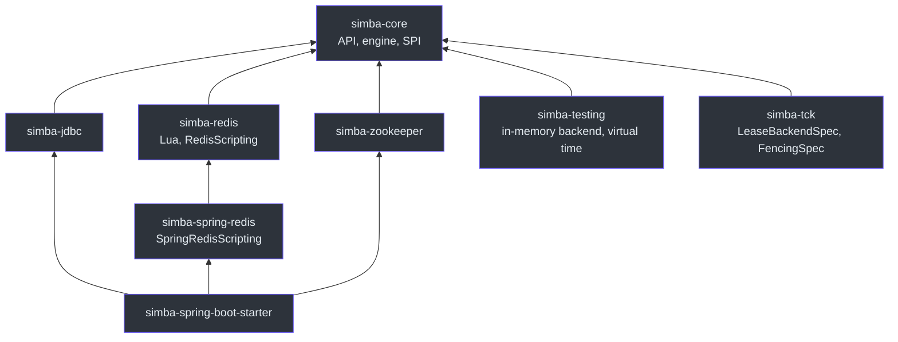
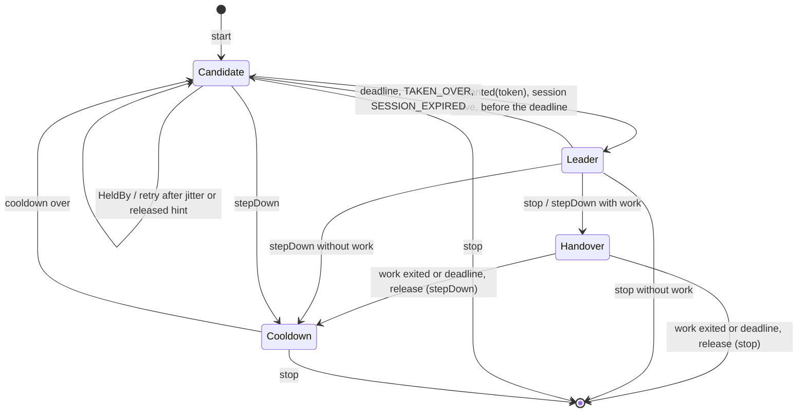

# Architecture

This page is for people changing Simba. It explains how the pieces fit and which rules they rely on;
[ADR 0010](https://github.com/Ahoo-Wang/Simba/blob/main/docs/adr/0010-simba-5-target-architecture.md) records why.

## Modules



`simba-core` knows no backend and depends only on kotlin-logging. `simba-redis` must not depend on Spring; the
starter depends on the backends as optional features. `simba-bom` and `simba-dependencies` are publication metadata;
`simba-example` is a runnable sample per backend.

## Layers

| Layer | Where | Role |
|---|---|---|
| User API | `Simba`, `Election`, `DistributedLock`, `PartitionGroup`, `Term` | Handles; no state of their own beyond what the engine publishes |
| Engine | `engine.step(state, event, now)` | Pure state machine: no threads, clock or I/O |
| Shell | `EngineShell` | Runs `step` on one loop thread, executes its effects: backend calls, timers, callbacks, group views |
| SPI | `LeaseBackend` | One round trip per call: sessions, leases, groups, optional hints |

### The Pure Engine

```kotlin
fun step(state: EngineState, event: Event, now: Long): Pair<EngineState, List<Effect>>
```

Events are `Boot`, `Start`, `Stop`, `StepDown`, `Timer`, `Reply` (a backend result, tagged with its request id and send
time), `Hint`, `WorkExited`, `Join`, `Leave` and `Close`. Effects are `Call` (a backend request), `Arm` (a timer),
`Deadline` (publish the session's local deadline to its terms), `Elected` / `Revoked`, `Complete` (a future),
`Publish` (a `SimbaEvent`) and `Members` (a group view). Because `step` is pure, every race is a sequence of events: unit
tests feed events and assert effects, and the [simulation](/guide/testing#deterministic-simulation) explores
interleavings over thousands of seeds.

### The Election State Machine



Rules the engine keeps:

- A term is adopted only from the reply to the election's current attempt, before the session's local deadline, and
  only with a token above every token the session released for that name.
- A term is revoked before its lease is released; releases carry the token.
- Keep-alive replies list the leases the session owns: a term adopted before the request but missing from the reply is
  revoked (`TAKEN_OVER`); an owned lease that nobody holds or is acquiring is released.
- An expired session is never revived: every term is revoked and a new session is opened.
- Handover: an election started with work keeps the lease of a stopped or stepped-down term until the work exited or
  the session's local deadline at the stop, whichever comes first; terms without work release at once.

## Threads

| Thread | Runs |
|---|---|
| Loop (one platform thread per client) | `step`, timers; the only thread touching engine state |
| I/O executor (default: a virtual thread per call) | Backend calls, with a timeout of one renew interval; at most one keep-alive per session and one acquire per election in flight |
| Callback executor (default: virtual threads) | `onElected` / `onRevoked`, through one serial dispatcher per election |
| Work executor (default: a virtual thread per term) | `runWhileLeader` / `schedule` / group work; interrupted on revocation |

The engine never waits for a callback except through the futures of `stop()` and `stepDown()`. Blocking `close()`
methods do not wait when called from a callback or leader work. `SimbaEventListener`s are called from the loop.

## Time

- The client never reads a wall clock for lease decisions. Every remaining time comes from the backend as a duration,
  and the local deadline is `sentAt + remaining × (1 − drift) − margin` on the monotonic clock (`Ticker`).
- `Term.isValid` and `remaining()` read the session's volatile deadline and the ticker; no watchdog thread has to run.
- Backends decide with their own clock: database `now` (JDBC), Redis `TIME`, Zookeeper session expiry.

## Wire Contracts

Nodes of the same major version may run together, so these must not change within 5.x:

- **Lease names:** 1–128 characters of `[A-Za-z0-9._:-]`; partition `p` of group `g` is `{g}.{p}`.
- **Partition assignment:** `PartitionAssignment.weight` (FNV-1a 64 of `"$partition@$member"` mixed with SplitMix64,
  members are session ids).
- **JDBC:** tables `simba_session`, `simba_lease`, `simba_member`; `simba_lease` rows are never deleted and release
  clears `session_id` only; every time comparison uses the dialect's `now` (UTC epoch ms); the take-over reads the
  holder's session row `for share`, serializing with its keep-alive; the MySQL acquire assigns `token` before
  `session_id` (left-to-right `SET`).
- **Redis:** `simba:lease:{name}` = `{session, token, expires}` (never expires, never deleted),
  `simba:session:{sid}` (`PX`) with `:leases` / `:groups`, `simba:group:{g}` scored by expiry, `released` published on
  the lease key; with `routeBySlot` every script call stays within one hash slot.
- **Zookeeper:** ephemeral `/simba/leases/{name}` (token = `czxid`), `/simba/groups/{g}/{sid}`.

## Design Records

| ADR | Decision |
|---|---|
| [0010](https://github.com/Ahoo-Wang/Simba/blob/main/docs/adr/0010-simba-5-target-architecture.md) | Simba 5: sessions, terms, a pure engine, one `LeaseBackend` SPI (supersedes 0001–0009 where they conflict) |
| [0002](https://github.com/Ahoo-Wang/Simba/blob/main/docs/adr/0002-fencing-token.md) | Fencing tokens; still holds |
| [0001](https://github.com/Ahoo-Wang/Simba/blob/main/docs/adr/0001-lease-contention-engine.md), [0003](https://github.com/Ahoo-Wang/Simba/blob/main/docs/adr/0003-simba-4.md)–[0009](https://github.com/Ahoo-Wang/Simba/blob/main/docs/adr/0009-partitioned-leadership.md) | The 4.x design: lease engine, 4.0, leader scheduling, observability, Actuator endpoint, lease validity and health, relinquish and handover, partitioned leadership |
