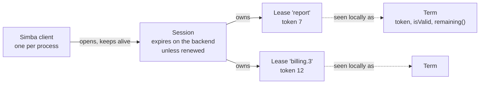
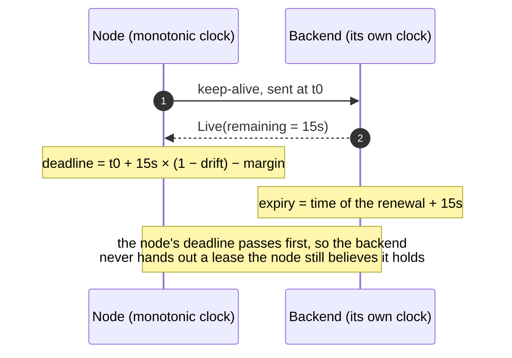
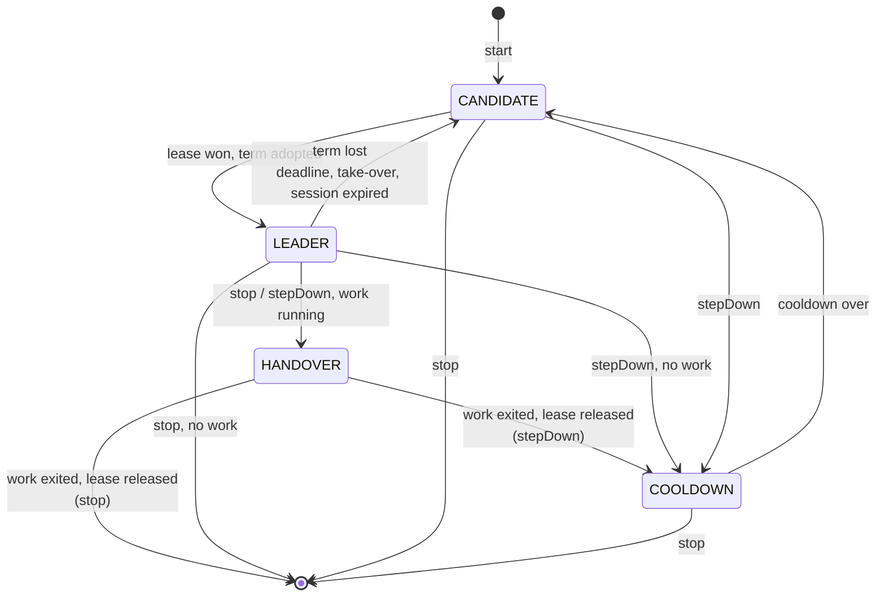
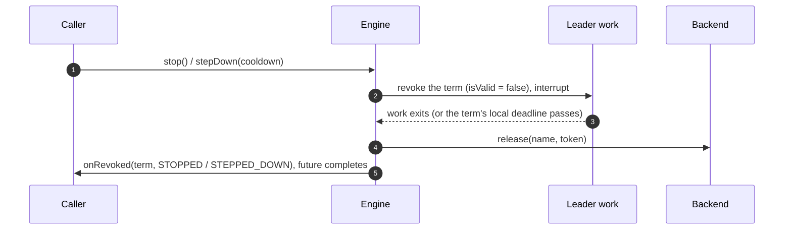

# How Simba Works

[Why Simba](/guide/) showed that safe mutual exclusion between processes needs leases, durations instead of
timestamps, and fencing tokens. This page builds the Simba model from those parts, one decision at a time. The design
is recorded in [ADR 0010](https://github.com/Ahoo-Wang/Simba/blob/main/docs/adr/0010-simba-5-target-architecture.md).



## Sessions: Liveness Belongs to the Process

A lease must expire when its holder stops renewing it. The thing that dies, though, is the *process*, not an
individual lock. So Simba renews liveness once per process: a `Simba` client opens **one session** on the backend and
keeps it alive with one keep-alive every `renewInterval`. Every lease the node holds and every group it joins lives and
dies with that session. Renewal costs one backend call per node, however many leases it holds.

Two rules keep sessions honest:

- **A session is never revived.** Once the backend has let a session expire, its leases may already belong to someone
  else. If a late keep-alive could bring the session back, a lease taken over in the meantime would become "mine"
  again. So the backend answers `Expired`, refuses the session's acquires, and the client opens a *new* session and
  contends from scratch.
- **A session id is never reused.** A `SessionId` names one session *incarnation*: random 128 bits on JDBC and Redis,
  the Zookeeper session id on Zookeeper. A restarted process is a new owner.

`close()` closes the session, which frees every lease of the node at once. Visible in
[`snapshot()`](/guide/observability#snapshot), a session is `OPENING` (none yet, or a new one after the last
expired), `LIVE` (the last keep-alive succeeded), `SUSPENDED` (the last keep-alive failed but the deadline has not
passed) or `CLOSED`.

## The Local Deadline: Durations, Not Timestamps

The node must stop considering itself owner *before* the backend can hand its leases to anyone else, without ever
comparing its clock with the backend's. Every keep-alive reply therefore carries the session's remaining time as a
**duration** measured by the backend's clock, and the client turns it into a deadline on its own monotonic clock:

```
deadline = sentAt + remaining × (1 − drift) − margin
```

Each term in that formula answers one way the node could overestimate its time:

| Term | Why |
|---|---|
| `sentAt` | The backend started counting `remaining` somewhere between sending and receiving. Counting from when the keep-alive was **sent** assumes the worst case, so a slow reply only shortens the deadline. |
| `× (1 − drift)` | The node's clock may run slower than the backend's. `drift` bounds that rate difference. |
| `− margin` | A fixed safety allowance on top. |



As long as the two clocks tick at rates within `1 ± drift` of each other, the local deadline passes before the backend
expires the session. Once the local deadline has passed, a late reply never extends it: the session ends
(`DEADLINE_PASSED`) and its terms stay ended. Every backend call also times out after the renew period in effect, so a
stuck call cannot hold the only keep-alive slot past the retries left before the deadline.

What drift does **not** cover is a *step* of a clock: an NTP step or a VM migration on a backend host shortens or
lengthens every lease at once. See [Failure Modes](/guide/correctness#failure-modes).

## Leases, Terms and Tokens

A **lease** is the backend record `name → (session, token)`. Names are 1–128 characters of `[A-Za-z0-9._:-]`, other
than `.` and `..`, on every backend, so the same name works as a Redis key, a Zookeeper path and a JDBC column.

A **term** is one period during which this node owns a lease, as a `Term` object. Winning the same name twice gives two
different `Term` objects, so code that received one term can never pick up the token of a later one.

| Member | Meaning |
|---|---|
| `name` | The lease name |
| `token` | Fencing token: greater than zero, constant within the term, strictly increasing across terms of the name |
| `isValid` | Not revoked and the session's local deadline has not passed |
| `remaining()` | Time left before the local deadline; `Duration.ZERO` once the term ended |
| `ensureValid(minRemaining)` | Throws `TermExpiredException` unless the term stays valid for more than `minRemaining` |
| `revoked` | `CompletionStage<RevokeReason>` that completes exactly once, when the term ends |

`isValid` and `remaining()` are pure functions of the monotonic clock and the session's deadline. No watchdog thread
has to run first, so a process waking from a long pause reads `false` on its first read, and an ended term never
becomes valid again, even if the node is re-elected.

A term ends for exactly one of these reasons:

| `RevokeReason` | When |
|---|---|
| `STOPPED` | The election was stopped, the lock released, or the client closed |
| `STEPPED_DOWN` | The election stepped down |
| `DEADLINE_PASSED` | The session's local deadline passed without a successful keep-alive |
| `SESSION_EXPIRED` | The backend reported the session expired |
| `TAKEN_OVER` | A keep-alive reply no longer lists the lease as owned by this session |

A term is always revoked **before** its lease is released, and every release carries the term's token, so a release
that arrives late is a no-op for any later term.

## Becoming Leader

A node that wants a lease and does not hold it is a **candidate**. It attempts to acquire every `renewInterval / 2`
plus a random jitter, with at most one attempt per election in flight. Redis and Zookeeper also broadcast releases, so
a clean stop of the leader is taken over at once there; on JDBC the next attempt picks it up.

A won lease becomes a term only if all of these hold, because each guards against a stale answer:

- the reply belongs to the election's **current** attempt (a late reply to an abandoned attempt releases what it won);
- it arrived **before** the session's local deadline;
- its token is **above** every token this session released for the name.

## The Lifecycle of an Election

An election moves through four states, the same `status` values that [`snapshot()`](/guide/observability#snapshot)
reports:



A term lost involuntarily (deadline, take-over, session expiry) sends the election straight back to `CANDIDATE`: it
keeps contending for the next term. A lock is the exception: it takes one term and is
[released for good](/guide/locks#losing-a-lock-early) when that term ends.

## Handover Order

When leadership moves voluntarily, the old leader's work must stop before the new leader's work starts. So `stop()`
and `stepDown(cooldown)` give the lease up in a fixed order when the election runs work (`runWhileLeader`,
`schedule`, a partition group, `@SimbaScheduled`, `@SimbaPartitioned`):



The lease stays held until the work exited or the session's local deadline at the stop passed, whichever comes first.
Work that ignores interruption therefore delays the handover by up to the term's remaining time. Terms without work
release at once.

A term lost any other way is **not** waited for: the backend may already have given the lease to another node, so
holding on would only pretend. The work is interrupted and the term revoked immediately.

`stepDown(cooldown)` keeps the election started but stops contending for `cooldown`, counted from the step-down: use
it to move leadership off a node before a deploy. `stop()` ends the election.

## Callbacks and Lifecycle

- Every `onElected(term)` is followed by exactly one `onRevoked(term, reason)` for the same term.
- Callbacks of one election run one at a time, in order, on a serial dispatcher over the callback executor (virtual
  threads by default). No internal lock is held while they run, and the engine never waits for a callback except
  through the futures of `stop()` and `stepDown()`.
- `stop()` and `stepDown()` return a `CompletionStage<Void>` that completes after the last `onRevoked` ran; after
  `stop()` completed, the listener receives nothing more.
- `start(listener)` throws `IllegalStateException` while the same name is already started on this client.
- Blocking `close()` methods (`Simba`, `LeaderTask`, `LockTerm`, `GroupTask`) do not wait when called from a callback
  or from leader work, where waiting would wait for itself.
- With a direct callback executor, callbacks run on the engine loop: chain on the stages the client returns there.
  Converting a pending one with `toCompletableFuture()` throws `IllegalStateException`, since waiting for it would
  block the loop that completes it.
- If the callback executor rejects an `onElected`, nobody learns of the term and its work never starts: the election
  steps down for one lease duration, and that term's `onRevoked` is not delivered either, so callbacks stay paired.

## Timing

| `SimbaConfig` | Default | Meaning |
|---|---|---|
| `leaseDuration` | 15 s | The backend expires a session this long after its last keep-alive |
| `renewInterval` | `leaseDuration / 3` | Keep-alive period |
| `drift` | 0.01 | Upper bound of the clock rate difference between a node and the backend, in `[0, 0.5)` |
| `margin` | 50 ms | Extra safety subtracted from every deadline |
| `retryJitter` | `renewInterval / 2` | Candidates retry after `renewInterval / 2` plus a random delay in `[0, retryJitter)` |
| `minBackoff` | 100 ms | Lower bound of the backoff after a failed keep-alive |

Build it with `SimbaConfig.builder()` (`toBuilder()` derives a variant). `build()` fails unless
`renewInterval × 2 ≤ leaseDuration`, so at least two keep-alive attempts fit before the deadline, and
`leaseDuration × (1 − drift) − margin > renewInterval`, since otherwise every term would flap. In Spring Boot these are
the [`simba.session.*`](/guide/configuration#properties) properties.

Each knob trades one thing for another:

- **`leaseDuration`** bounds failover after a crash or a partition: the other nodes can take a lease over only after
  the session expired on the backend. Shorter means faster failover but less tolerance for slow backend calls and GC
  pauses.
- **`renewInterval`** is how often the node calls the backend. A keep-alive call times out after one renew interval;
  after a failure the client retries with halving backoff (half the time left, capped at `renewInterval`, at least
  `minBackoff`) until the deadline.
- **`drift`** and **`margin`** only shorten the local view of the lease. Raise them if your hosts' clocks are poorly
  disciplined or run in VMs that can be paused.

A backend may grant less than `leaseDuration`; a Zookeeper server, for example, caps the session timeout at its
`maxSessionTimeout`. When two keep-alives at `renewInterval` no longer fit in the local validity it grants, the client
renews every third of that validity instead and publishes `SessionLeaseShortened` (and a warning) once per session,
rather than letting every term end with `DEADLINE_PASSED`. Zookeeper always grants less: a keep-alive proves the
session alive at the leader only for `5/12` of the session timeout (see [Backends](/guide/backends#zookeeper)), so with
the default lease it renews about every two seconds.

## Next

The model above bounds what a node *believes*. What it may still *do* after a pause, and how your resource stops it,
is on [Fencing and Failures](/guide/correctness).
