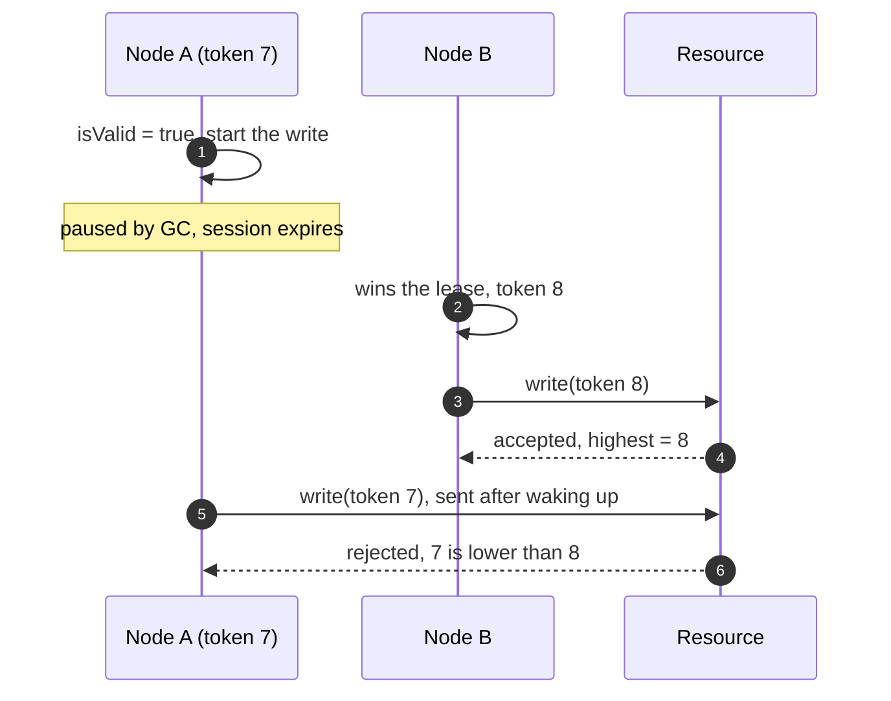

# Fencing and Failures

[How Simba Works](/guide/concepts) bounds what a node *believes*: its term ends before the backend can hand the lease
to anyone else. This page is about what a node may still *do* after it stopped being owner, and what your code must do
when that must never matter.

## Why a Valid Term Is Not Enough

Checking `term.isValid` before a write narrows the window for a stale write; it cannot close it. The process can pause
right after the check:



Only the resource sees both writes, so only the resource can decide. It needs a number that grows with every new
owner and survives pauses: the term's **fencing token**.

## The Fencing Protocol

1. Pass `term.token` with every write to the protected resource.
2. The resource accepts a write only if its token is **at least** the highest token it has accepted, and records it.
   Equal tokens must be accepted: retries within one term carry the same token.
3. The check and the write are **one atomic step**. Reading the highest token first and writing afterwards lets a
   stale owner pass the check and land its write after a newer owner.

### Recipes

**SQL**: one conditional `UPDATE`; zero matched rows means a stale owner.

```sql
-- once per resource: insert ignore into ledger_state (id) values (?);
update ledger_state
set last_batch = ?, fencing_token = ?
where id = ? and fencing_token <= ?;
```

MySQL Connector/J reports matched rows by default, so a retry with the same token and values still counts as `1`.

**Redis**: one Lua script; keep the token and the value in the same hash slot (`{resource}`) for Redis Cluster.

```lua
-- KEYS[1] = {resource}:token, KEYS[2] = {resource}:value, ARGV[1] = token, ARGV[2] = value
local highest = tonumber(redis.call('get', KEYS[1]) or '0')
if tonumber(ARGV[1]) < highest then
    return 0
end
redis.call('set', KEYS[1], ARGV[1])
redis.call('set', KEYS[2], ARGV[2])
return 1
```

**In one JVM**: check and write under the same lock.

```kotlin
synchronized(state) {
    if (fencingToken < state.highestToken) return false
    state.highestToken = fencingToken
    state.write(value)
    return true
}
```

### Verify Your Resource

`simba-tck` ships `FencingSpec`, a JUnit kit that races writers against your resource; see
[Testing](/guide/testing#verifying-a-fencing-resource). The recipes above pass it
([`JdbcFencingRecipeTest`](https://github.com/Ahoo-Wang/Simba/blob/main/simba-jdbc/src/test/kotlin/me/ahoo/simba/jdbc/JdbcFencingRecipeTest.kt),
[`RedisFencingRecipeTest`](https://github.com/Ahoo-Wang/Simba/blob/main/simba-redis/src/test/kotlin/me/ahoo/simba/redis/RedisFencingRecipeTest.kt)).

## Where Tokens Come From

A token is only as monotonic as the storage that counts it:

| Backend | Token source | Can it go back? |
|---|---|---|
| JDBC | `simba_lease.token`, `+1` per term; rows are never deleted | Only if the database loses committed data, e.g. a failover to an asynchronous replica |
| Redis | `token` field of `simba:lease:{name}`, `+1` per term | Yes, after a failover that loses recent writes or an eviction: see [token regression](/guide/backends#token-regression-after-a-failover) |
| Zookeeper | `czxid` of the lease node: strictly increasing, not consecutive | Only if the ensemble's data is lost or restored from an older snapshot |

## Check Before Each Step

`term.ensureValid(minRemaining)` throws `TermExpiredException` unless the term stays valid for more than
`minRemaining`. Call it before a step that should not start when the term is about to end:

```kotlin
simba.election("ledger").runWhileLeader { term ->
    for (batch in batches) {
        term.ensureValid(Duration.ofSeconds(2))   // expected duration of one batch
        ledger.settle(batch, fencingToken = term.token)
    }
}
```

This keeps an owner from *starting* work it cannot finish in time. It does not stop a pause *after* the check, which is
why the resource still checks the token.

## Choosing Your Protection

| The protected step is... | Do |
|---|---|
| A write to storage that can compare a number atomically | Fence it with `term.token` |
| A call to a system that cannot check tokens (an email, a payment API) | Make it idempotent with a key derived from the work, not from the term; fencing cannot help there |
| Merely wasteful when repeated | Rely on the term; check `ensureValid` before long steps |

After any failover the next leader may redo the last step of the previous one, so idempotent work is cheaper to run
under every one of these choices.

## Failure Modes

| Situation | What happens |
|---|---|
| Leader process crashes | Its session expires after `leaseDuration` (Zookeeper: the session timeout); a candidate acquires at its next attempt. |
| Leader stops cleanly | Work exits, the lease is released; Redis and Zookeeper candidates acquire at once, JDBC candidates at their next attempt. |
| Backend unreachable | Session `SUSPENDED`, keep-alive retried with backoff; at the local deadline every term of the node is revoked (`DEADLINE_PASSED`) and a new session is opened once the backend answers. Nothing keeps running as leader meanwhile. |
| Backend reports the session expired | Every term revoked (`SESSION_EXPIRED`), new session, contend again. |
| Leader paused longer than the lease (GC, VM freeze) | On waking, `term.isValid` is already `false`; the engine revokes the term. Writes already in flight can still land: the [fencing token](#the-fencing-protocol) is the only defense. |
| Keep-alive shows the lease owned by someone else | Term revoked (`TAKEN_OVER`). |
| Zookeeper follower loses the leader | The follower still answers reads for up to `syncLimit` ticks while the leader stops seeing the session and expires it. Keep-alives `sync` through the leader, so they fail on such a follower and the local deadline runs out; it never outlasts the leader's view of the session. |
| Clock rate differs by more than `drift` | The safety argument no longer holds; raise `drift`. |
| Redis failover loses recent writes | A token can go back; see [Backends](/guide/backends#token-regression-after-a-failover). |
| Redis evicts keys under memory pressure (`allkeys-*` policy) | An evicted lease hash restarts its token at 1, so tokens go back; use `noeviction` or a dedicated instance, see [Backends](/guide/backends#memory-eviction). |
| Failover to an asynchronous database replica (MySQL replica, PostgreSQL standby promotion) | Like a Redis failover: recent token increments and keep-alives can be lost, so a token can go back. Use synchronous replication when fencing must hold; see [Backends](/guide/backends#jdbc-operating-notes). |
| Backend host's clock steps (NTP step, VM migration) | JDBC and Redis measure leases with that clock, so every lease shortens (forward step) or lengthens (backward step) at once. A forward step can expire a holder's lease on the backend while its local deadline has not passed: another node can win a term while the old holder still reads `isValid`. This is not rate drift and `drift` does not cover it; only the fencing token protects. Run the backend hosts with slewing time sync. |
