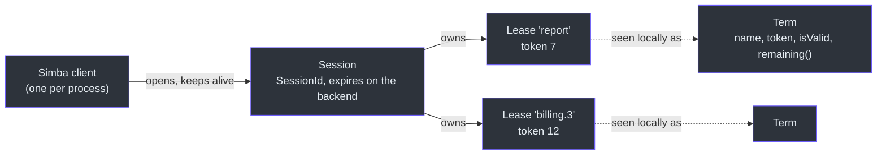
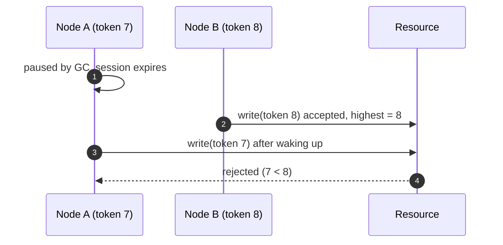
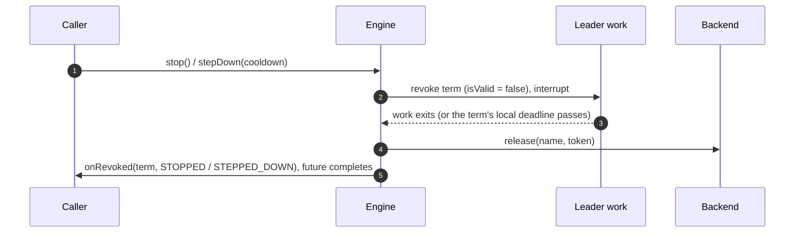

# Concepts and Correctness

A distributed lock cannot know that its holder is still alive; it can only *lease* ownership for a bounded time.
Everything Simba guarantees follows from that. This page explains the model, the timing, and what your code has to do
when overlapping work must never happen. The design is recorded in
[ADR 0010](https://github.com/Ahoo-Wang/Simba/blob/main/docs/adr/0010-simba-5-target-architecture.md).

## The Model in One Picture



## Sessions

Liveness belongs to the node, not to each lock. A `Simba` client opens **one session** on the backend and renews it
with one keep-alive every `renewInterval`; every lease the node holds and every group it joined lives and dies with
that session. Renewal cost is one call per node, whatever the number of leases.

- A `SessionId` identifies one session *incarnation* and is never reused: random 128 bits on JDBC and Redis, the
  Zookeeper session id on Zookeeper.
- An expired session is **never revived**. The backend answers `Expired` to its keep-alive and refuses its acquires;
  the client opens a new session (a new id) and contends again. Otherwise a lease another node had taken over in the
  meantime could become "mine" again.
- `close()` closes the session, so the backend frees every lease of the node at once.

The session status, visible in [`snapshot()`](/guide/observability#snapshot), is `OPENING` (no session yet, or a new
one after the last expired), `LIVE` (last keep-alive succeeded), `SUSPENDED` (last keep-alive failed, deadline not
passed) or `CLOSED`.

## The Local Deadline

The client never compares wall clocks with the backend. Each keep-alive reply carries the session's remaining time as
a *duration* measured by the backend, and the client turns it into a deadline on its own monotonic clock:

```
deadline = sentAt + remaining × (1 − drift) − margin
```

`sentAt` is when the keep-alive was **sent**, not when the reply arrived, so a slow reply only shortens the deadline.
Every backend call times out after the renew period in effect (shorter when the backend grants less than the lease),
so a stuck call never holds the only keep-alive slot past the retries left before the deadline. As long as the two
clocks run at rates within `1 ± drift` of each other, the local deadline passes before the backend
can expire the session and give its leases to someone else. Once the local deadline has passed, a renewal that arrives
late never extends it: the session ends (`DEADLINE_PASSED`) and its terms stay ended.

## Leases, Terms and Tokens

A **lease** is a backend record `name → (session, token)`. Lease names are 1–128 characters of `[A-Za-z0-9._:-]`,
other than `.` and `..`, on every backend, so a name means the same as a Redis key, a Zookeeper path and a JDBC column.

A **term** is one period during which this node owns a lease. Winning the same name twice gives two different
`Term` objects. A term carries:

| Member | Meaning |
|---|---|
| `name` | The lease name |
| `token` | Fencing token: greater than zero, constant within the term, strictly increasing across terms of the name |
| `isValid` | Not revoked and the session's local deadline has not passed |
| `remaining()` | Time left before the local deadline; `Duration.ZERO` once the term ended |
| `ensureValid(minRemaining)` | Throws `TermExpiredException` unless the term is valid for more than `minRemaining` |
| `revoked` | `CompletionStage<RevokeReason>` that completes exactly once, when the term ends |

`isValid` and `remaining()` are pure functions of the monotonic clock and the session's deadline: no watchdog thread
has to run first, so a process that wakes from a long pause sees `false` on its first read, and an ended term never
becomes valid again even if the node is re-elected.

A term ends for one of these reasons:

| `RevokeReason` | When |
|---|---|
| `STOPPED` | The election was stopped, the lock released, or the client closed |
| `STEPPED_DOWN` | The election stepped down |
| `DEADLINE_PASSED` | The session's local deadline passed without a successful keep-alive |
| `SESSION_EXPIRED` | The backend reported the session expired |
| `TAKEN_OVER` | A keep-alive reply no longer lists the lease as owned by this session |

A term is always revoked **before** its lease is released, and every release carries the term's token, so a release
that arrives late cannot free a later term.

## Timing

| `SimbaConfig` | Default | Meaning |
|---|---|---|
| `leaseDuration` | 15 s | The backend expires a session this long after its last keep-alive |
| `renewInterval` | `leaseDuration / 3` | Keep-alive period |
| `drift` | 0.01 | Upper bound of the clock rate difference between a node and the backend, in `[0, 0.5)` |
| `margin` | 50 ms | Extra safety subtracted from every deadline |
| `retryJitter` | `renewInterval / 2` | Candidates retry after `renewInterval / 2` plus a random delay in `[0, retryJitter)` |
| `minBackoff` | 100 ms | Lower bound of the backoff after a failed keep-alive |

Build it with `SimbaConfig.builder()` (`toBuilder()` derives a variant); `build()` fails unless
`renewInterval × 2 ≤ leaseDuration` (at least two keep-alive attempts fit before the deadline) and
`leaseDuration × (1 − drift) − margin > renewInterval` (otherwise every term would flap). In Spring Boot these are the
[`simba.session.*`](/guide/configuration#properties) properties.

A backend may grant less than `leaseDuration` — a Zookeeper server caps the session timeout at its
`maxSessionTimeout`. When two keep-alives at `renewInterval` no longer fit in the local validity it grants, the client
renews every third of that validity instead and publishes `SessionLeaseShortened` (and a warning) once per session,
rather than letting every term end with `DEADLINE_PASSED`.

How to choose:

- **`leaseDuration`** bounds failover after a crash or a partition: the other nodes can take a lease over only after
  the session expired on the backend. Shorter means faster failover but less tolerance for slow backend calls and GC
  pauses.
- **`renewInterval`** is how often the node calls the backend. A keep-alive call times out after one renew interval;
  after a failure the client retries with halving backoff (half the time left, capped at `renewInterval`, at least
  `minBackoff`) until the deadline.
- **`drift`** and **`margin`** only shorten the local view of the lease; raise them if your hosts' clocks are poorly
  disciplined or run in VMs that can be paused.

## Candidates

A node that wants a lease and does not hold it is a *candidate*. Candidates attempt to acquire every
`renewInterval / 2` plus jitter. Redis and Zookeeper also broadcast releases, so a clean stop of the leader is taken
over at once there; on JDBC the next attempt picks it up. At most one acquire per election is in flight.

A term is adopted only from the reply to the election's current attempt, received before the session's local
deadline, and only with a token above every token this session released for the name. A late reply to an abandoned
attempt releases what it won.

## Fencing Tokens

A term's validity is a hint for when to *start* a step, never proof that nobody else owns the lease. Only the
protected resource can reject a stale owner, and it needs the token to do so:

1. Pass `term.token` with every write to the protected resource.
2. The resource accepts the write only if the token is **at least** the highest token it has accepted, and records
   it. Equal tokens must be accepted: retries within one term carry the same token.



### Checking Tokens in the Resource

The check and the write must be **one atomic step**. Reading the highest token first and writing afterwards lets a
stale owner pass the check and land its write after a newer owner.

**SQL** — one conditional `UPDATE`; zero matched rows means a stale owner:

```sql
-- once per resource: insert ignore into ledger_state (id) values (?);
update ledger_state
set last_batch = ?, fencing_token = ?
where id = ? and fencing_token <= ?;
```

MySQL Connector/J reports matched rows by default, so a retry with the same token and values still counts as `1`.

**Redis** — one Lua script; keep the token and the value in the same hash slot (`{resource}`) for Redis Cluster:

```lua
-- KEYS[1] = {resource}:token, KEYS[2] = {resource}:value, ARGV[1] = token, ARGV[2] = value
local highest = tonumber(redis.call('get', KEYS[1]) or '0')
if tonumber(ARGV[1]) < highest then
    return 0
end
redis.call('set', KEYS[1], ARGV[1])
redis.call('set', KEYS[2], ARGV[2])
return 1
```

**In one JVM** — check and write under the same lock:

```kotlin
synchronized(state) {
    if (fencingToken < state.highestToken) return false
    state.highestToken = fencingToken
    state.write(value)
    return true
}
```

### Verifying a Resource

`simba-tck` ships `FencingSpec`, a JUnit test kit for your own resource; see
[Testing](/guide/testing#verifying-a-fencing-resource). The recipes above pass it
([`JdbcFencingRecipeTest`](https://github.com/Ahoo-Wang/Simba/blob/main/simba-jdbc/src/test/kotlin/me/ahoo/simba/jdbc/JdbcFencingRecipeTest.kt),
[`RedisFencingRecipeTest`](https://github.com/Ahoo-Wang/Simba/blob/main/simba-redis/src/test/kotlin/me/ahoo/simba/redis/RedisFencingRecipeTest.kt)).

| Backend | Token source | Caveat |
|---|---|---|
| JDBC | `simba_lease.token`, `+1` per term | Rows are never deleted, so the token never resets |
| Redis | `token` field of `simba:lease:{name}`, `+1` per term | Asynchronous replication: [can go back after a failover](/guide/backends#token-regression-after-a-failover) |
| Zookeeper | `czxid` of the lease node | Strictly increasing but not consecutive |

## Checking the Term Before Each Step

`term.ensureValid(minRemaining)` throws `TermExpiredException` unless the term stays valid for more than
`minRemaining`. Call it before a step that should not start when the term is about to end:

```kotlin
simba.election("ledger").runWhileLeader { term ->
    for (batch in batches) {
        term.ensureValid(Duration.ofSeconds(2))   // expected duration of one batch
        ledger.settle(batch, fencingToken = term.token)
    }
}
```

This narrows the window in which an expired owner starts new work; it does not close it. A pause *after* the check is
still possible, which is why the resource must check the token.

## Handover Order

`stop()` and `stepDown(cooldown)` give the lease up in a fixed order when the election runs work
(`runWhileLeader`, `schedule`, a partition group, `@SimbaScheduled`, `@SimbaPartitioned`):



The lease stays held until the work exited or the session's local deadline at the stop passed, whichever comes first,
so no other node starts the same work while the old run is still finishing. Work that ignores interruption therefore
delays the handover up to the term's remaining time. Terms without work release at once.

A term lost any other way (deadline, take-over, session expiry) is not waited for: the backend may already have given
the lease to another node, so the work is interrupted and the term revoked immediately.

`stepDown(cooldown)` keeps the election started but does not contend for `cooldown`, counted from the step-down: use
it to move leadership off a node before a deploy or to drain it. `stop()` ends the election.

## Callbacks and Lifecycle

- Every `onElected(term)` is followed by exactly one `onRevoked(term, reason)` for the same term.
- Callbacks of one election run one at a time, in order, on a serial dispatcher over the callback executor (virtual
  threads by default). No internal lock is held while they run, and the engine never waits for a callback except
  through the futures of `stop()` and `stepDown()`.
- `stop()` and `stepDown()` return a `CompletionStage<Void>` that completes after the last `onRevoked` ran; after
  `stop()` completes, the listener receives nothing more.
- `start(listener)` throws `IllegalStateException` while the same name is already started on this client.
- Blocking `close()` methods (`Simba`, `LeaderTask`, `LockTerm`, `GroupTask`) do not wait when called from a
  callback or from leader work, where waiting would wait for itself.
- With a direct callback executor, callbacks run on the engine loop: chain on the stages the client returns there.
  Converting a pending one with `toCompletableFuture()` throws `IllegalStateException`, since waiting for it would
  block the loop that completes it.
- If the callback executor rejects an `onElected`, nobody learns of the term and its work never starts: the election
  steps down for one lease duration, and that term's `onRevoked` is not delivered either, so callbacks stay paired.

## Failure Modes

| Situation | What happens |
|---|---|
| Leader process crashes | Its session expires after `leaseDuration` (Zookeeper: the session timeout); a candidate acquires at its next attempt. |
| Leader stops cleanly | Work exits, the lease is released; Redis and Zookeeper candidates acquire at once, JDBC candidates at their next attempt. |
| Backend unreachable | Session `SUSPENDED`, keep-alive retried with backoff; at the local deadline every term of the node is revoked (`DEADLINE_PASSED`) and a new session is opened once the backend answers. Nothing keeps running as leader meanwhile. |
| Backend reports the session expired | Every term revoked (`SESSION_EXPIRED`), new session, contend again. |
| Leader paused longer than the lease (GC, VM freeze) | On waking, `term.isValid` is already `false`; the engine revokes the term. Writes already in flight can still land: the [fencing token](#fencing-tokens) is the only defense. |
| Keep-alive shows the lease owned by someone else | Term revoked (`TAKEN_OVER`). |
| Clock rate differs by more than `drift` | The safety argument no longer holds; raise `drift`. |
| Redis failover loses recent writes | A token can go back; see [Backends](/guide/backends#token-regression-after-a-failover). |
| Redis evicts keys under memory pressure (`allkeys-*` policy) | An evicted lease hash restarts its token at 1, so tokens go back; use `noeviction` or a dedicated instance, see [Backends](/guide/backends#memory-eviction). |
| Failover to an asynchronous database replica (MySQL replica, PostgreSQL standby promotion) | Like a Redis failover: recent token increments and keep-alives can be lost, so a token can go back. Use synchronous replication when fencing must hold; see [Backends](/guide/backends#operating-notes). |
| Backend host's clock steps (NTP step, VM migration) | JDBC and Redis measure leases with that clock, so every lease shortens (forward step) or lengthens (backward step) at once. A forward step can expire a holder's lease on the backend while its local deadline has not passed: another node can win a term while the old holder still reads `isValid`. This is not rate drift and `drift` does not cover it; only the fencing token protects. Run the backend hosts with slewing time sync. |
