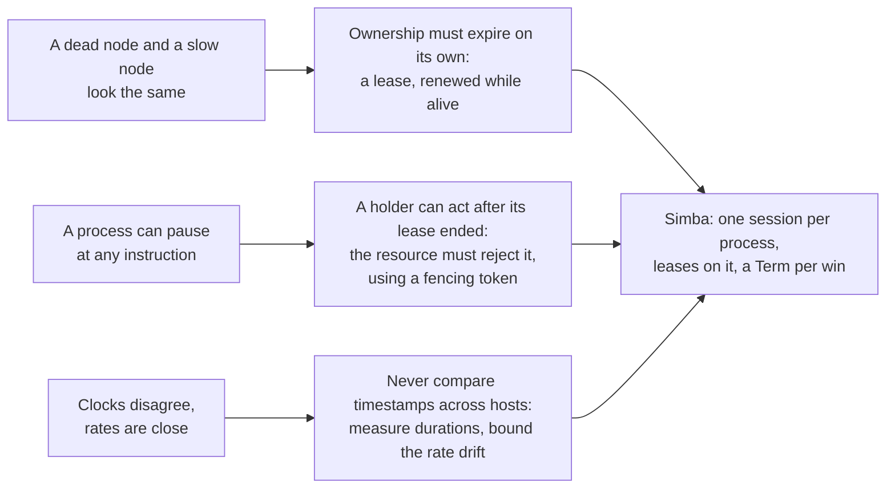

# Why Simba

Some work must be done by **one node at a time**: a nightly report, the consumer of a partition, the process that
drives a workflow, the step that charges an invoice. Inside one JVM a `synchronized` block does this. Across
processes it is a different problem, and the shape of any honest solution follows from three facts about distributed
systems. This page derives that shape; Simba is that shape, packaged as a library.

## Three Facts

**1. A dead node and a slow node look the same.** When a node stops answering, the others cannot tell whether it
crashed, is stuck in a long GC, or is cut off by the network. No message can prove it is gone.

**2. A process can pause at any instruction.** Garbage collection, a VM freeze, a page fault on a swapped-out page or a
stalled disk can stop a process for seconds, between any two lines of your code, without the process noticing.

**3. Clocks do not agree, but they tick at similar rates.** Wall clocks on different hosts differ by unknown amounts and
can jump (NTP steps, VM migration). What is reliable is that each host's monotonic clock measures elapsed time at a
rate close to every other host's.

## What They Force

Each fact rules out a naive design and forces one mechanism:

- **A lock that waits for its holder to release it is unsafe**: if the holder is dead, it waits forever (fact 1).
  Ownership must therefore be a **lease**: granted for a bounded time and kept only by renewing it. When a node stops
  renewing, for whatever reason, its lease runs out and another node can take over.
- **A lease alone cannot stop a paused holder** (fact 2). The holder checks "my lease is valid", pauses, the lease runs
  out, another node takes over, and the first node wakes up and writes. No check on the holder's side can close that
  gap, because the pause can fall right after the check. Only the **resource being written** can refuse the stale
  writer, and it needs something to compare: a **fencing token** that grows with every new owner.
- **"Valid until 12:00:15" means nothing on another host** (fact 3). The backend therefore reports how much time is
  *left*, as a duration measured by its own clock, and each node turns that into a deadline on its own monotonic clock,
  shortened by an allowance for the rate difference. That way a node always considers its lease over *before* the
  backend could give it to someone else.

These three mechanisms are not one design among many: every correct lease-based scheme has them, and none can do
better without the protected resource taking part. Simba implements them once, on storage you already run, with no
Simba server. How the pieces fit is explained in [How Simba Works](/guide/concepts).

## What Simba Guarantees

1. **At most one valid term per lease name, as far as the local clock can tell.** Winning a lease gives the node a
   *term*. A term is valid until the session's local deadline, which passes before the backend can hand the lease to
   another session, as long as the clock rates of node and backend differ by less than the configured `drift`.
   Validity is recomputed from the monotonic clock on every read, so a process waking from a long pause sees its term
   as invalid on the first read.
2. **Fencing tokens.** Every term carries a token greater than zero that strictly increases from term to term of the
   same name, on every backend.
3. **Paired callbacks.** Every `onElected(term)` is followed by exactly one `onRevoked(term, reason)`; callbacks of one
   election run one at a time, in order, and none arrives after `stop()` completed.
4. **Ordered handover.** `stop()` and `stepDown()` interrupt the work bound to the term, wait for it to exit (at most
   until the term's local deadline), and only then release the lease.
5. **Liveness.** A node that closes its client frees its leases at once. A node that crashes or loses the backend
   stops renewing its session, the session expires after `leaseDuration`, and the other nodes take its leases over.

## What Simba Cannot Guarantee

A term is a **weakly consistent view** of the backend. A process paused by GC, a stalled disk or a network partition can
resume after its session expired and still finish a write it had already started, while another node holds a newer
term. No lease-based lock can prevent that on its own, so Simba never promises "no split-brain".

What to do about it depends on what an overlap costs:

| If two owners overlapping briefly is... | Then |
|---|---|
| **Harmful** (money moves twice, data is corrupted) | Send `term.token` with every write and let the resource reject tokens lower than the highest it accepted: [Fencing and Failures](/guide/correctness) |
| **Wasteful** (a report is generated twice) | The term alone is enough; make the work idempotent where you can |

Simba also does not keep anything running while the backend is unreachable: once the session's local deadline passes,
every term of that node is revoked. A coordination service that cannot be reached cannot coordinate.

## Choose an API

All APIs hang off one `Simba` client per process, which owns one backend session.

| You want to... | Use | Page |
|---|---|---|
| Run a block while this node leads, interrupted when it stops leading | `election.runWhileLeader { term -> }` | [Leader Work](/guide/leader-work#run-while-leader) |
| Run a job periodically, on one node only | `election.schedule(...)` or `@SimbaScheduled` | [Leader Work](/guide/leader-work#schedules) |
| Spread N partitions of work over the live nodes | `simba.group(name, n)` or `@SimbaPartitioned` | [Leader Work](/guide/leader-work#partition-groups) |
| React to gaining and losing leadership yourself | `election.start(listener)` | [Leader Work](/guide/leader-work#elections) |
| Hold a lock around one step, then release it | `simba.lock(name).acquire(timeout)` | [Locks](/guide/locks) |
| See this node's session and elections | `simba.snapshot()`, Actuator `simba` | [Observability](/guide/observability) |

Prefer the highest level that fits: work bound to a term (`runWhileLeader`, `schedule`, groups) gets the handover
order for free, while a bare listener leaves it to you.

## Choose a Backend

Pick the one you already operate. All three pass the same [TCK](/guide/testing#backend-tck); they differ in where time
is measured and how durable the token is.

| | JDBC (MySQL 8, PostgreSQL 14+) | Redis 7 | Zookeeper |
|---|---|---|---|
| Lease time measured by | Database clock | Redis `TIME` | Zookeeper session timeout |
| Fencing token | Counter in a row, `+1` per term | Counter in a hash, `+1` per term | The node's `czxid` |
| Takeover after a clean stop | Next candidate attempt | Immediate (release broadcast) | Immediate (node watch) |
| Takeover after a crash | About `leaseDuration` | About `leaseDuration` | About the negotiated session timeout |
| Token survives a failover | With synchronous replication | Not guaranteed (asynchronous replication) | Yes (quorum commits) |

If fencing must hold across a backend failover, prefer Zookeeper or JDBC on synchronous replication; see
[Backends](/guide/backends) for the details and operating notes.

## Where to Next

1. [Quick Start](/guide/quick-start): add the dependency and run code.
2. [How Simba Works](/guide/concepts): sessions, deadlines, terms and the handover order.
3. [Fencing and Failures](/guide/correctness): read before protecting anything that must not be written twice.
