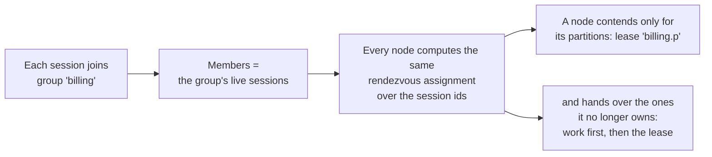

# Elections and Leader Work

An **election** is the long-running form of a lease: the node contends for a name, holds a term while it can, and
contends again whenever it loses one. What you usually want, though, is not "know that I lead" but "run this code only
while I lead". Simba therefore offers four levels, each built on the one before:

| Level | API | You get |
|---|---|---|
| Listen | `election.start(listener)` | `onElected` / `onRevoked`; the work is yours to start, stop and hand over |
| Run | `election.runWhileLeader { term -> }` | A block per term, interrupted when the term ends, handed over in order |
| Schedule | `election.schedule(schedule) { term -> }` | A loop per term on a fixed delay or rate |
| Partition | `simba.group(name, n).schedule { term, partition -> }` | N elections spread over the live nodes |

Prefer the highest level that fits. Work started through Simba is **bound to one term**: it receives that `Term`, runs
only while the term lasts, and is interrupted when it ends. It never reads "the current leadership state", so a run
that started in one term can never use the token of a later one, and `stop()` waits for it before releasing the lease
([Handover Order](/guide/concepts#handover-order)).

## Elections

```kotlin
val election = simba.election("order-dispatcher")
election.start(object : LeadershipListener {
    override fun onElected(term: Term) = dispatcher.start(term.token)
    override fun onRevoked(term: Term, reason: RevokeReason) = dispatcher.stop()
})
```

| Member | Behavior |
|---|---|
| `start(listener)` | Starts contending; throws `IllegalStateException` while the name is already started on this client |
| `stop()` | Stops contending; the `CompletionStage` completes after the last `onRevoked` ran (at once when not started) |
| `stepDown(cooldown)` | Gives up the current term and does not contend for `cooldown`; the election stays started |

Handles returned by `simba.election(name)` for the same name share one election. Callbacks run one at a time per
election and must stay short; see [Callbacks and Lifecycle](/guide/concepts#callbacks-and-lifecycle). With a bare
listener nothing waits for your work before the lease is released, so prefer `runWhileLeader` for anything that runs
for a while.

## Run While Leader

```kotlin
val task: LeaderTask = simba.election("ingest").runWhileLeader { term ->
    val cursor = cursors.load()
    while (term.isValid) {
        val batch = source.poll(cursor) ?: continue
        sink.write(batch, fencingToken = term.token)
    }
}
```

- The election starts at once. The block runs once per term, each time on a new virtual thread of the client's work
  executor (or on the `Executor` passed as the first argument).
- When the term is revoked, its thread is interrupted and `term.revoked` completes. Write the block so that it stops on
  interruption or when `term.isValid` turns `false`.
- A block that returns early keeps the term until it ends; the block does not run again until the next term.
- Exceptions are logged and published as `SimbaEvent.WorkCompleted` with outcome `FAILED` (or `CANCELLED` once the term
  has ended); they never affect the election. The exception is a `VirtualMachineError` (out of memory, stack
  overflow): it ends the term's work, the election steps down for one lease duration, and the error is rethrown to the
  work thread.
- `task.stop()` stops the election and completes once the current work exited (or ran out of time) and the lease is
  released; `task.close()` does the same and waits.

`runWhileLeader` and `schedule` throw `IllegalStateException` when the election is already started on this client.

## Schedules

`schedule` is `runWhileLeader` plus a loop: one loop per term, on one virtual thread, calling `term.ensureValid()`
before every run.

```kotlin
simba.election("report").schedule(
    Schedule.fixedRate(Duration.ofMinutes(1)).withInitialDelay(Duration.ofSeconds(10))
) { term ->
    reportService.generate(fencingToken = term.token)
}
```

| Factory | Period measured |
|---|---|
| `Schedule.fixedDelay(delay, initialDelay = 0)` | From the end of one run to the start of the next |
| `Schedule.fixedRate(period, initialDelay = 0)` | Between scheduled starts; a run that overruns skips the missed starts instead of bursting |

`initialDelay` counts from the start of each term, and the period must be positive. A failed run (an `Error` included)
is logged and published, and the loop goes on; a `VirtualMachineError` ends the loop and steps the election down for
one lease duration. The loop ends with its term. There is no thread pool per schedule.

## Partition Groups

Some work splits into independent shards, and you want every live node to take a share, each shard on exactly one node
at a time. A partition group spreads `partitions` partitions over the live nodes of the group:

```kotlin
val task: GroupTask = simba.group("billing", partitions = 16)
    .schedule(Schedule.fixedDelay(Duration.ofMinutes(1))) { term, partition ->
        billing.run(shard = partition, fencingToken = term.token)
    }

task.partitions()   // partitions this node runs in its latest view
```

It is built from parts you already know:



1. **Membership is the session.** The client's session joins the group on the backend, so membership needs no
   heartbeat of its own and disappears with the session.
2. **Assignment is computed, not negotiated.** Every node derives the same assignment from the member list with
   rendezvous hashing (`PartitionAssignment`, over session ids), so a node joining or leaving moves only the partitions
   it gains or loses.
3. **Each partition is an ordinary election** of the lease `"{group}.{p}"`. A node contends only for the partitions
   assigned to it and hands over the others with the usual [handover order](/guide/concepts#handover-order).
4. The member view is refreshed on backend membership hints (Zookeeper) and every renew interval.

While nodes disagree about the member list during a change, two of them may both want a partition, but the lease still
lets at most one hold a valid term: the assignment only decides who *contends*. Every member must use the same
`partitions`. The group name follows the lease name rules, and `"{group}.{partitions - 1}"` must fit in 128
characters.

`runWhileLeader { term, partition -> }` is available too. `GroupTask.stop()` leaves the group and stops every
partition, completing once each one handed over, including partitions an earlier view moved away that are still
handing over.

## Spring Annotations

### `@SimbaScheduled`

```java
@Service
public class ReportJobs {
    @SimbaScheduled(name = "report", fixedDelay = "1m", initialDelay = "10s")
    public void generate(Term term) {
        reportService.generate(term.getToken());
    }
}
```

| Attribute | Description |
|---|---|
| `name` | Election (lease name) whose leader runs the method; unique per application |
| `fixedDelay` | Delay between the end of one run and the start of the next |
| `fixedRate` | Period between the starts of consecutive runs |
| `initialDelay` | Delay before the first run of each term (default `0s`) |

Set exactly one of `fixedDelay` and `fixedRate`. The method takes no parameter or a single `Term`.

### `@SimbaPartitioned`

```java
@Service
public class Billing {
    @SimbaPartitioned(group = "billing", partitions = 16, fixedDelay = "1m")
    public void bill(Term term, int partition) {
        billing.run(partition, term.getToken());
    }
}
```

| Attribute | Description |
|---|---|
| `group` | Group name, unique per application; partition `p` is elected as `"{group}.{p}"` |
| `partitions` | Number of partitions; every member must use the same value |
| `fixedDelay` / `fixedRate` / `initialDelay` | As for `@SimbaScheduled`, per partition |

The method takes `(Term, int)`.

String attributes of both annotations accept `${...}` placeholders, and durations use the Spring Boot formats (`10s`,
`500ms`, `PT1M`). The lease names they elect and the groups share one namespace across both annotations: startup fails
on a conflict. Methods start after the context refreshed and stop on shutdown before the client closes (see
[Shutdown Order](/guide/configuration#shutdown-order)); disable them with `simba.scheduling.enabled=false`.

## Writing Good Leader Work

- **Pass `term.token` to every write** the work makes to a shared resource. A paused node can still land a write after
  its term ended; only a resource that checks the [fencing token](/guide/correctness#the-fencing-protocol) rejects it.
- **Stop on interruption.** Blocking I/O that ignores interruption delays the handover by up to the term's remaining
  time.
- **Check before long steps:** `term.ensureValid(expectedStepDuration)` throws `TermExpiredException` instead of
  starting a step that would outlive the term.
- **Make work idempotent** where you can: after a failover the next leader may redo the last step.
