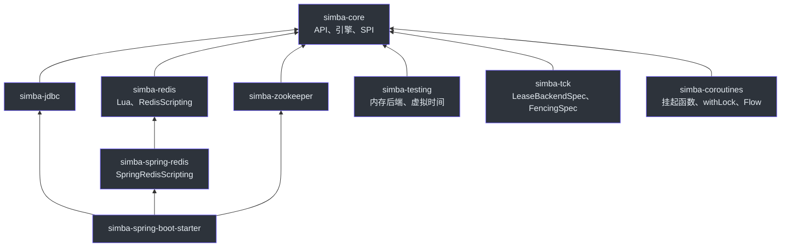
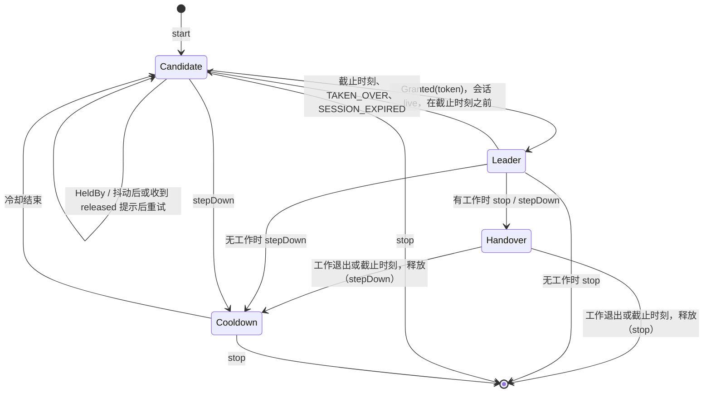

# 架构

本页面向修改 Simba 的人。它说明各部分如何组合以及它们依赖的规则；
[ADR 0010](https://github.com/Ahoo-Wang/Simba/blob/main/docs/adr/0010-simba-5-target-architecture.md) 记录了原因。

## 模块 {#modules}



`simba-core` 不了解任何后端，只依赖 kotlin-logging。`simba-redis` 不得依赖 Spring；starter 以可选特性的方式依赖各后端。
`simba-bom` 和 `simba-dependencies` 是发布元数据；`simba-example` 是每种后端可运行的示例。

## 分层 {#layers}

| 层 | 位置 | 作用 |
|---|---|---|
| 用户 API | `Simba`、`Election`、`DistributedLock`、`PartitionGroup`、`Term` | 句柄；除引擎发布的内容外没有自己的状态 |
| 引擎 | `engine.step(state, event, now)` | 纯状态机：没有线程、时钟或 I/O |
| 外壳 | `EngineShell` | 在一个循环线程上运行 `step`，执行其效果：后端调用、定时器、回调、组视图 |
| SPI | `LeaseBackend` | 每个方法只发出有限次数的调用：会话、租约、组、可选的提示 |

### 纯引擎 {#the-pure-engine}

```kotlin
fun step(state: EngineState, event: Event, now: Long): Pair<EngineState, List<Effect>>
```

事件有 `Boot`、`Start`、`Stop`、`StepDown`、`Timer`、`Reply`（后端结果，带有请求 id 和发送时间）、`Hint`、`WorkExited`、`Join`、
`Leave` 和 `Close`。效果有 `Call`（后端请求）、`Arm`（定时器）、`Deadline`（把会话的本地截止时刻发布给其任期）、`Elected` / `Revoked`、
`Complete`（一个 future）、`Publish`（一个 `SimbaEvent`）和 `Members`（组视图）。由于 `step` 是纯函数，每种竞态都是一个事件序列：
单元测试输入事件并断言效果，[模拟](/zh/guide/testing#deterministic-simulation) 则在数千个种子上探索各种交错。

### 选举状态机 {#the-election-state-machine}



引擎遵守的规则：

- 只有来自该选举当前尝试的回复、在会话的本地截止时刻之前、且 token 大于会话为该名称释放过的所有 token 时，才会采纳一个任期。
- 任期先被撤销，再释放其租约；释放携带 token。
- 续约（keep-alive）回复列出会话持有的租约：在请求之前采纳、但不在回复中的任期会被撤销（`TAKEN_OVER`）；无人持有也无人正在获取的已拥有租约会被释放。
- 过期的会话永不复活：撤销所有任期并打开一个新会话。
- 交接：带工作启动的选举会保留已停止或已让位任期的租约，直到工作退出或到达 stop 时会话的本地截止时刻，以先到者为准；没有工作的任期立即释放。

## 线程 {#threads}

| 线程 | 运行内容 |
|---|---|
| 循环线程（每个客户端一个平台线程） | `step`、定时器；唯一接触引擎状态的线程 |
| I/O 执行器（默认：每次调用一个虚拟线程） | 后端调用，超时为一个续约间隔；每个会话最多一个在途续约，每个选举最多一个在途获取 |
| 回调执行器（默认：虚拟线程） | `onElected` / `onRevoked`，每个选举经由一个串行分发器 |
| 工作执行器（默认：每个任期一个虚拟线程） | `runWhileLeader` / `schedule` / 组工作；撤销时被中断 |

除了通过 `stop()` 和 `stepDown()` 的 future 之外，引擎从不等待回调。阻塞的 `close()` 方法在回调或 leader 任务中调用时不会等待。
`SimbaEventListener` 由循环线程调用。

## 时间 {#time}

- 客户端从不为租约决策读取挂钟。每个剩余时间都以时长的形式来自后端，本地截止时刻在单调时钟（`Ticker`）上为
  `sentAt + remaining × (1 − drift) − margin`。
- `Term.isValid` 和 `remaining()` 读取会话的 volatile 截止时刻和 ticker；不需要运行看门狗线程。
- 后端使用自己的时钟做决策：数据库 `now`（JDBC）、Redis `TIME`、Zookeeper 会话过期。

## 线协议约定 {#wire-contracts}

同一主版本的节点可以一起运行，因此以下内容在 5.x 内不得改变：

- **租约名称：** 1–128 个 `[A-Za-z0-9._:-]` 字符；组 `g` 的分区 `p` 为 `{g}.{p}`。
- **分区分配：** `PartitionAssignment.weight`（对 `"$partition@$member"` 计算 FNV-1a 64 并与 SplitMix64 混合，成员为会话 id）。
- **JDBC：** 表 `simba_session`、`simba_lease`、`simba_member`；`simba_lease` 行永不删除，释放只清空 `session_id`；
  所有时间比较都使用方言的 `now`（UTC epoch 毫秒）；接管时以 `for share` 读取持有者的会话行，与其续约串行化；MySQL 的获取在
  `session_id` 之前赋值 `token`（`SET` 从左到右求值）。
- **Redis：** `simba:lease:{name}` = `{session, token, expires}`（永不过期、永不删除），`simba:session:{sid}`（`PX`）及
  `:leases` / `:groups`，按过期时间计分的 `simba:group:{g}`，`released` 发布在租约键上；启用 `routeBySlot` 时每次脚本调用都限制在一个 hash slot 内。
- **Zookeeper：** 临时节点 `/simba/leases/{name}`（token = `czxid`）、`/simba/groups/{g}/{sid}`。

## 设计记录 {#design-records}

| ADR | 决策 |
|---|---|
| [0010](https://github.com/Ahoo-Wang/Simba/blob/main/docs/adr/0010-simba-5-target-architecture.md) | Simba 5：会话、任期、纯引擎、单一 `LeaseBackend` SPI（与 0001–0009 冲突之处以本记录为准） |
| [0002](https://github.com/Ahoo-Wang/Simba/blob/main/docs/adr/0002-fencing-token.md) | Fencing token；仍然有效 |
| [0001](https://github.com/Ahoo-Wang/Simba/blob/main/docs/adr/0001-lease-contention-engine.md)、[0003](https://github.com/Ahoo-Wang/Simba/blob/main/docs/adr/0003-simba-4.md)–[0009](https://github.com/Ahoo-Wang/Simba/blob/main/docs/adr/0009-partitioned-leadership.md) | 4.x 的设计：租约引擎、4.0、leader 调度、可观测性、Actuator 端点、租约有效性与健康检查、relinquish 与交接、分区领导权 |
