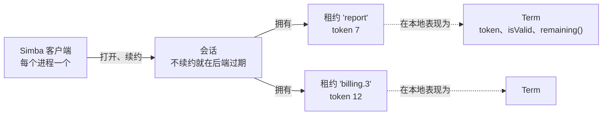
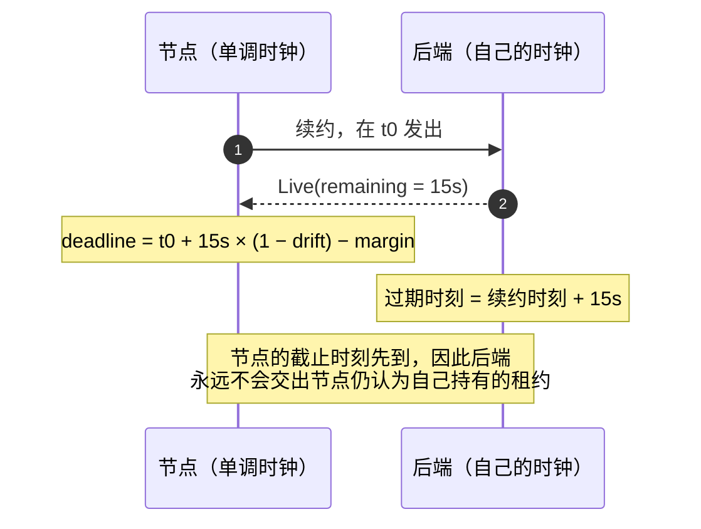
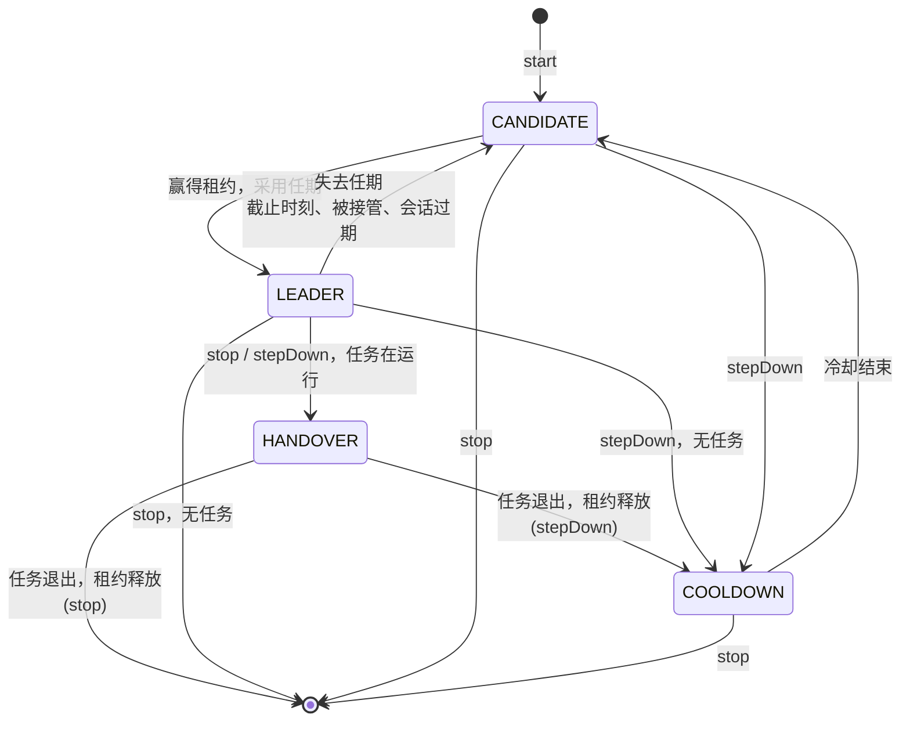
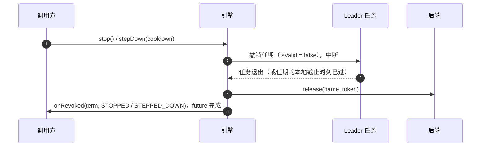

# Simba 如何工作

[为什么选择 Simba](/zh/guide/) 说明了进程间安全的互斥需要租约、用时长代替时间戳，以及 fencing token。本页用这些部件逐个决策地构建出
Simba 的模型。设计记录在 [ADR 0010](https://github.com/Ahoo-Wang/Simba/blob/main/docs/adr/0010-simba-5-target-architecture.md) 中。



## 会话：存活性属于进程 {#sessions-liveness-belongs-to-the-process}

租约必须在持有者停止续约时过期。然而真正会死掉的是 *进程*，而不是某一把锁。所以 Simba 按进程续约存活性：一个 `Simba` 客户端在后端打开
**一个会话**，每隔 `renewInterval` 用一次续约让它保持存活。节点持有的每个租约、加入的每个分组都随这个会话存续、随它结束。
无论持有多少租约，续约的代价都是每个节点一次后端调用。

两条规则保证会话可信：

- **会话永不复活。** 后端一旦让会话过期，它的租约可能已经属于别人。如果迟到的续约能让会话复活，期间被接管的租约就会重新变成“我的”。
  因此后端回答 `Expired`，拒绝该会话的获取请求，客户端打开一个 *新* 会话并从头开始竞争。
- **会话 id 永不重用。** 一个 `SessionId` 指代一个会话 *化身*：在 JDBC 和 Redis 上是随机的 128 位，在 Zookeeper 上是 Zookeeper
  会话 id。重启后的进程是一个新的所有者。

`close()` 关闭会话，立即释放节点的所有租约。在 [`snapshot()`](/zh/guide/observability#snapshot) 中可以看到会话的状态：
`OPENING`（尚无会话，或上一个过期后正在打开新会话）、`LIVE`（最近一次续约成功）、`SUSPENDED`（最近一次续约失败，但截止时刻未过）
或 `CLOSED`。

## 本地截止时刻：时长，而非时间戳 {#the-local-deadline-durations-not-timestamps}

节点必须在后端可能把它的租约交给任何人 *之前* 就不再认为自己是所有者，而且永远不拿自己的时钟与后端的时钟比较。因此每个续约应答都携带会话的剩余时间，
它是一段由后端时钟度量的 **时长**，客户端再把它换算成自己单调时钟上的截止时刻：

```
deadline = sentAt + remaining × (1 − drift) − margin
```

公式中的每一项都对应节点可能高估自身时间的一种情形：

| 项 | 原因 |
|---|---|
| `sentAt` | 后端在发送与接收之间的某个时刻开始计算 `remaining`。从续约 **发出** 时开始计时是按最坏情况估计，因此慢应答只会缩短截止时刻。 |
| `× (1 − drift)` | 节点的时钟可能比后端走得慢。`drift` 限定这一速率差。 |
| `− margin` | 额外的固定安全余量。 |



只要两个时钟的走速相差在 `1 ± drift` 以内，本地截止时刻就会在后端让会话过期之前到达。本地截止时刻一旦过去，迟到的应答也不会再延长它：
会话结束（`DEADLINE_PASSED`），其任期保持结束状态。每次后端调用也会在当前生效的续约周期后超时，因此一个卡住的调用不会占着唯一的续约名额，
耗尽截止时刻前剩余的重试机会。

drift **不** 覆盖时钟的 *跳变*：后端主机上的一次 NTP 步进或虚拟机迁移会让所有租约同时变短或变长。见
[故障模式](/zh/guide/correctness#failure-modes)。

## 租约、任期与 token {#leases-terms-and-tokens}

**租约** 是后端记录 `name → (session, token)`。在所有后端上，名称都是 1–128 个 `[A-Za-z0-9._:-]` 字符，且不能是 `.` 或 `..`，
因此同一个名称既能作 Redis 键，也能作 Zookeeper 路径和 JDBC 列值。

**任期** 是本节点拥有某个租约的一段时期，表现为一个 `Term` 对象。两次赢得同一名称会得到两个不同的 `Term` 对象，因此收到某个任期的代码
永远拿不到后一个任期的 token。

| 成员 | 含义 |
|---|---|
| `name` | 租约名称 |
| `token` | Fencing token：大于零，在任期内不变，在同一名称的各任期间严格递增 |
| `isValid` | 未被撤销，且会话的本地截止时刻未过 |
| `remaining()` | 距本地截止时刻的剩余时间；任期结束后为 `Duration.ZERO` |
| `ensureValid(minRemaining)` | 除非任期还能保持有效超过 `minRemaining`，否则抛出 `TermExpiredException` |
| `revoked` | `CompletionStage<RevokeReason>`，在任期结束时恰好完成一次 |

`isValid` 和 `remaining()` 是单调时钟与会话截止时刻的纯函数。不需要先运行某个看门狗线程，因此从长时间暂停中醒来的进程第一次读取就得到 `false`，
而且已结束的任期永远不会重新变为有效，即使节点再次当选。

任期恰好因以下原因之一结束：

| `RevokeReason` | 何时 |
|---|---|
| `STOPPED` | 选举被停止、锁被释放，或客户端被关闭 |
| `STEPPED_DOWN` | 选举让位 |
| `DEADLINE_PASSED` | 会话的本地截止时刻已过，且没有成功的续约 |
| `SESSION_EXPIRED` | 后端报告会话已过期 |
| `TAKEN_OVER` | 续约应答不再把该租约列为本会话所有 |

任期总是在其租约释放 **之前** 被撤销，而且每次释放都携带该任期的 token，因此迟到的释放对之后的任何任期都是空操作。

## 成为 leader {#becoming-leader}

想要某个租约但尚未持有的节点是 **候选者**。它每隔 `renewInterval / 2` 加一个随机抖动尝试获取一次，每个选举同时至多有一次尝试在进行。
Redis 和 Zookeeper 还会广播释放，因此在它们上面 leader 正常停止后会被立即接管；在 JDBC 上则由下一次尝试接手。

赢得的租约只有在以下条件全部满足时才成为任期，因为每一条都防范一种过期的应答：

- 应答属于该选举的 **当前** 尝试（已放弃的尝试迟到的应答会释放它赢得的租约）；
- 它在会话的本地截止时刻 **之前** 到达；
- 它的 token **高于** 本会话为该名称释放过的每一个 token。

## 选举的生命周期 {#the-lifecycle-of-an-election}

选举在四个状态之间转换，与 [`snapshot()`](/zh/guide/observability#snapshot) 报告的 `status` 值相同：



非自愿失去的任期（截止时刻、被接管、会话过期）会让选举直接回到 `CANDIDATE`：它继续竞争下一个任期。锁是例外：它只取一个任期，
该任期结束时就 [永久释放](/zh/guide/locks#losing-a-lock-early)。

## 交接顺序 {#handover-order}

当领导权自愿转移时，旧 leader 的任务必须在新 leader 的任务开始之前停止。因此当选举运行着任务（`runWhileLeader`、`schedule`、分区组、
`@SimbaScheduled`、`@SimbaPartitioned`）时，`stop()` 和 `stepDown(cooldown)` 按固定顺序交出租约：



租约会一直保持，直到任务退出或停止时会话的本地截止时刻已过，以先到者为准。因此忽略中断的任务最多会把交接推迟任期的剩余时间。
没有任务的任期立即释放。

以其他方式失去的任期 **不** 等待：后端可能已经把租约交给了另一个节点，继续持有只是自欺欺人。任务被中断，任期立即撤销。

`stepDown(cooldown)` 让选举保持启动状态，但在 `cooldown` 内停止竞争，从让位时开始计时：可在部署前用它把领导权从某个节点移走。
`stop()` 则结束选举。

## 回调与生命周期 {#callbacks-and-lifecycle}

- 每个 `onElected(term)` 之后，同一任期恰好跟随一个 `onRevoked(term, reason)`。
- 同一选举的回调按顺序逐个执行，运行在回调执行器（默认虚拟线程）之上的串行调度器中。回调运行时不持有任何内部锁，
  而且引擎从不等待回调，除了通过 `stop()` 和 `stepDown()` 的 future。
- `stop()` 和 `stepDown()` 返回一个 `CompletionStage<Void>`，在最后一个 `onRevoked` 执行完后完成；`stop()` 完成之后，
  监听器不会再收到任何东西。
- 同一名称已在本客户端上启动时，`start(listener)` 抛出 `IllegalStateException`。
- 阻塞的 `close()` 方法（`Simba`、`LeaderTask`、`LockTerm`、`GroupTask`）在回调或 Leader 任务中调用时不会等待，因为在那里等待就是在等自己。
- 使用直接回调执行器时，回调运行在引擎循环上：在那里只能对客户端返回的 stage 做链式调用。对一个未完成的 stage 调用
  `toCompletableFuture()` 会抛出 `IllegalStateException`，因为等待它会阻塞负责完成它的循环。
- 如果回调执行器拒绝了某个 `onElected`，没有人得知这个任期，它的任务也永远不会启动：选举让位一个租约时长，且该任期的 `onRevoked`
  也不会投递，从而回调保持成对。

## 时间参数 {#timing}

| `SimbaConfig` | 默认值 | 含义 |
|---|---|---|
| `leaseDuration` | 15 s | 后端在会话最后一次续约之后经过这么久让其过期 |
| `renewInterval` | `leaseDuration / 3` | 续约周期 |
| `drift` | 0.01 | 节点与后端时钟速率差的上界，取值 `[0, 0.5)` |
| `margin` | 50 ms | 从每个截止时刻额外减去的安全余量 |
| `retryJitter` | `renewInterval / 2` | 候选者在 `renewInterval / 2` 加上 `[0, retryJitter)` 内的随机延迟后重试 |
| `minBackoff` | 100 ms | 续约失败后退避时间的下限 |

用 `SimbaConfig.builder()` 构建（`toBuilder()` 派生变体）。除非满足 `renewInterval × 2 ≤ leaseDuration`（保证截止时刻前至少能容纳两次续约尝试）
以及 `leaseDuration × (1 − drift) − margin > renewInterval`（否则每个任期都会反复抖动），否则 `build()` 会失败。在 Spring Boot 中，
它们对应 [`simba.session.*`](/zh/guide/configuration#properties) 属性。

每个参数都是一种取舍：

- **`leaseDuration`** 限定崩溃或分区后的故障转移时间：只有会话在后端过期之后，其他节点才能接管租约。越短故障转移越快，
  但对缓慢的后端调用和 GC 暂停的容忍度越低。
- **`renewInterval`** 是节点调用后端的频率。续约调用在一个续约周期后超时；失败后客户端以减半的退避重试（剩余时间的一半，
  上限 `renewInterval`，下限 `minBackoff`），直到截止时刻。
- **`drift`** 和 **`margin`** 只会缩短本地对租约的认知。如果主机时钟校准不佳，或运行在可能被暂停的虚拟机中，就调大它们。

后端授予的时间可能少于 `leaseDuration`；例如 Zookeeper 服务端会把会话超时限制在其 `maxSessionTimeout` 以内。当按 `renewInterval`
的两次续约已放不进它授予的本地有效期时，客户端改为每隔该有效期的三分之一续约一次，并且每个会话发布一次 `SessionLeaseShortened`
（以及一条警告），而不是让每个任期都以 `DEADLINE_PASSED` 结束。Zookeeper 授予的时间总是更少：一次续约只能证明会话在 leader 上
存活会话超时的 `5/12`（见 [后端](/zh/guide/backends#zookeeper)），因此在默认租约下，大约每两秒续约一次。

## 下一步 {#next}

上面的模型限定了节点 *认为* 的东西。暂停之后它仍可能 *做* 什么，以及你的资源如何阻止它，见 [Fencing 与故障](/zh/guide/correctness)。
