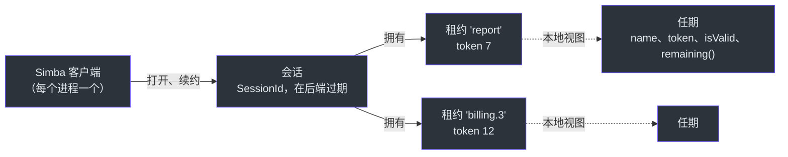
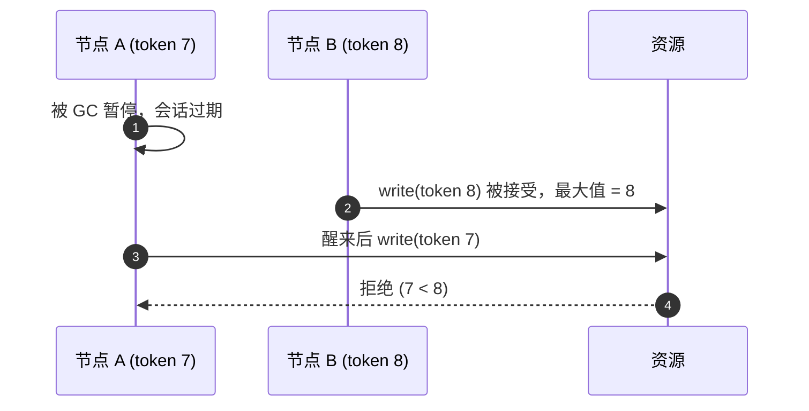
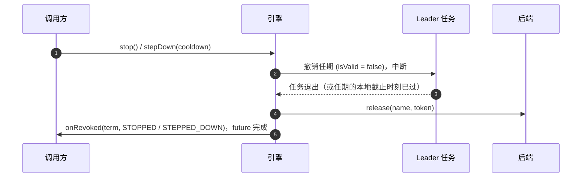

# 核心概念与正确性

分布式锁无法知道它的持有者是否还活着；它只能把所有权 *租* 出去一段有限的时间。Simba 的所有保证都由此而来。
本页说明模型、时序，以及当重叠执行绝不能发生时你的代码需要做什么。设计记录在
[ADR 0010](https://github.com/Ahoo-Wang/Simba/blob/main/docs/adr/0010-simba-5-target-architecture.md) 中。

## 一图看懂模型 {#the-model-in-one-picture}



## 会话 {#sessions}

活性属于节点，而不是每把锁。一个 `Simba` 客户端在后端打开 **一个会话**，并每隔 `renewInterval` 用一次续约 (keep-alive) 为其续期；
节点持有的每个租约和加入的每个组都与该会话同生共死。无论租约有多少，续期开销都是每个节点一次调用。

- 一个 `SessionId` 标识一次会话 *实例*，且永不复用：在 JDBC 和 Redis 上是随机 128 位，在 Zookeeper 上是 Zookeeper 会话 id。
- 过期的会话 **永不复活**。后端对它的续约回复 `Expired`，并拒绝它的获取请求；客户端会打开一个新会话（新的 id）并重新竞争。
  否则，一个在此期间已被其他节点接管的租约可能会重新变成“我的”。
- `close()` 关闭会话，因此后端会立即释放该节点的所有租约。

会话状态可在 [`snapshot()`](/zh/guide/observability#snapshot) 中查看：`OPENING`（还没有会话，或上一个过期后正在打开新会话）、
`LIVE`（上一次续约成功）、`SUSPENDED`（上一次续约失败，截止时刻未过）或 `CLOSED`。

## 本地截止时刻 {#the-local-deadline}

客户端从不把自己的挂钟与后端比较。每次续约的回复都携带会话的剩余时间，这是由后端测量的一个 *时长*，客户端把它换算成自己单调时钟上的截止时刻：

```
deadline = sentAt + remaining × (1 − drift) − margin
```

`sentAt` 是续约请求 **发出** 的时刻，而不是回复到达的时刻，因此慢回复只会缩短截止时刻。每次后端调用都在当前生效的续约周期后超时（后端给的时间少于租期时会更短），因此卡住的调用不会占着唯一的续约名额，越过截止时刻前剩余的重试机会。
只要两个时钟的速率之比在
`1 ± drift` 之内，本地截止时刻就会在后端让会话过期并把其租约交给别人之前到达。本地截止时刻一旦已过，迟到的续约回复不会再延长它：
会话按 `DEADLINE_PASSED` 结束，其任期保持结束状态。

## 租约、任期与 Token {#leases-terms-and-tokens}

**租约** 是后端的一条记录 `name → (session, token)`。在所有后端上，租约名称都是 1–128 个 `[A-Za-z0-9._:-]` 字符（不能是 `.` 或 `..`），
因此一个名称作为 Redis 键、Zookeeper 路径和 JDBC 列值时含义相同。

**任期** 是本节点拥有某个租约的一段时期。两次赢得同一名称会得到两个不同的 `Term` 对象。任期包含：

| 成员 | 含义 |
|---|---|
| `name` | 租约名称 |
| `token` | Fencing token：大于零，在任期内不变，在同一名称的任期之间严格递增 |
| `isValid` | 未被撤销，且会话的本地截止时刻未过 |
| `remaining()` | 距本地截止时刻的剩余时间；任期结束后为 `Duration.ZERO` |
| `ensureValid(minRemaining)` | 除非任期在超过 `minRemaining` 的时间内仍然有效，否则抛出 `TermExpiredException` |
| `revoked` | `CompletionStage<RevokeReason>`，在任期结束时恰好完成一次 |

`isValid` 和 `remaining()` 是单调时钟与会话截止时刻的纯函数：不需要先运行任何看门狗线程，因此一个从长时间暂停中醒来的进程在第一次读取时就会看到
`false`，而且已结束的任期即使节点再次当选也不会重新变为有效。

任期因以下原因之一结束：

| `RevokeReason` | 何时 |
|---|---|
| `STOPPED` | 选举被停止、锁被释放或客户端被关闭 |
| `STEPPED_DOWN` | 选举让位 |
| `DEADLINE_PASSED` | 会话的本地截止时刻已过，期间没有成功的续约 |
| `SESSION_EXPIRED` | 后端报告会话已过期 |
| `TAKEN_OVER` | 续约回复不再把该租约列为本会话所有 |

任期总是 **先** 被撤销，然后才释放其租约；每次释放都携带任期的 token，因此迟到的释放无法释放之后的任期。

## 时序 {#timing}

| `SimbaConfig` | 默认值 | 含义 |
|---|---|---|
| `leaseDuration` | 15 s | 后端在会话最后一次续约之后经过这么长时间使其过期 |
| `renewInterval` | `leaseDuration / 3` | 续约周期 |
| `drift` | 0.01 | 节点与后端之间时钟速率差异的上界，取值 `[0, 0.5)` |
| `margin` | 50 ms | 从每个截止时刻额外减去的安全余量 |
| `retryJitter` | `renewInterval / 2` | 候选者在 `renewInterval / 2` 加上 `[0, retryJitter)` 内的随机延迟后重试 |
| `minBackoff` | 100 ms | 续约失败后退避时间的下限 |

用 `SimbaConfig.builder()` 构建（`toBuilder()` 可派生变体）；除非 `renewInterval × 2 ≤ leaseDuration`（截止时刻之前至少能容纳两次续约尝试）且
`leaseDuration × (1 − drift) − margin > renewInterval`（否则每个任期都会抖动），否则 `build()` 会失败。在 Spring Boot 中，它们对应
[`simba.session.*`](/zh/guide/configuration#properties) 属性。

后端给出的时间可能少于 `leaseDuration`——Zookeeper 服务端会把会话超时限制在 `maxSessionTimeout` 以内。当它给出的本地有效期内已容纳不下两次间隔为
`renewInterval` 的续约时，客户端改为每隔本地有效期的三分之一续约一次，并且每个会话发布一次 `SessionLeaseShortened`（同时记录 warn 日志），
而不是让每个任期都以 `DEADLINE_PASSED` 结束。

如何选择：

- **`leaseDuration`** 决定崩溃或分区后故障转移的时间上界：只有在会话于后端过期之后，其他节点才能接管租约。越短故障转移越快，
  但对慢后端调用和 GC 暂停的容忍度越低。
- **`renewInterval`** 是节点调用后端的频率。一次续约调用在一个续约间隔后超时；失败后，客户端以减半的退避（剩余时间的一半，上限为
  `renewInterval`，至少 `minBackoff`）重试，直到截止时刻。
- **`drift`** 和 **`margin`** 只会缩短本地看到的租约；如果主机时钟校准较差，或运行在可能被暂停的虚拟机中，请调大它们。

## 候选者 {#candidates}

想要某个租约但尚未持有它的节点是 *候选者*。候选者每隔 `renewInterval / 2` 加抖动尝试获取一次。Redis 和 Zookeeper 还会广播释放，
因此在这两个后端上 leader 正常停止后会被立即接管；在 JDBC 上则由下一次尝试接手。每个选举至多同时有一个获取请求在途。

只有当回复对应选举当前的尝试、在会话的本地截止时刻之前收到、并且 token 大于本会话为该名称释放过的所有 token 时，任期才会被采纳。
对已放弃的尝试迟到的回复会释放它所赢得的租约。

## Fencing Token {#fencing-tokens}

任期的有效性只是何时 *开始* 一个步骤的提示，从来不能证明没有别人拥有该租约。只有被保护的资源才能拒绝过期的持有者，而它需要 token 才能做到：

1. 每次写入被保护的资源时都传入 `term.token`。
2. 资源只在 token **不小于** 它已接受的最大 token 时才接受写入，并记录该 token。相等的 token 必须被接受：同一任期内的重试携带相同的 token。



### 在资源中检查 Token {#checking-tokens-in-the-resource}

检查与写入必须是 **一个原子步骤**。先读取最大 token、再写入，会让过期的持有者通过检查，并在较新的持有者之后完成写入。

**SQL** —— 一条条件 `UPDATE`；匹配零行表示过期的持有者：

```sql
-- once per resource: insert ignore into ledger_state (id) values (?);
update ledger_state
set last_batch = ?, fencing_token = ?
where id = ? and fencing_token <= ?;
```

MySQL Connector/J 默认报告匹配的行数，因此使用相同 token 和相同值的重试仍然计为 `1`。

**Redis** —— 一个 Lua 脚本；对于 Redis Cluster，把 token 和值放在同一个哈希槽（`{resource}`）中：

```lua
-- KEYS[1] = {resource}:token, KEYS[2] = {resource}:value, ARGV[1] = token, ARGV[2] = value
local highest = tonumber(redis.call('get', KEYS[1]) or '0')
if tonumber(ARGV[1]) < highest then
    return 0
end
redis.call('set', KEYS[1], ARGV[1])
redis.call('set', KEYS[2], ARGV[2])
return 1
```

**在单个 JVM 内** —— 在同一把锁下检查并写入：

```kotlin
synchronized(state) {
    if (fencingToken < state.highestToken) return false
    state.highestToken = fencingToken
    state.write(value)
    return true
}
```

### 验证资源 {#verifying-a-resource}

`simba-tck` 提供 `FencingSpec`，这是一个针对你自己资源的 JUnit 测试套件；见
[测试](/zh/guide/testing#verifying-a-fencing-resource)。上面的示例都能通过它
（[`JdbcFencingRecipeTest`](https://github.com/Ahoo-Wang/Simba/blob/main/simba-jdbc/src/test/kotlin/me/ahoo/simba/jdbc/JdbcFencingRecipeTest.kt)、
[`RedisFencingRecipeTest`](https://github.com/Ahoo-Wang/Simba/blob/main/simba-redis/src/test/kotlin/me/ahoo/simba/redis/RedisFencingRecipeTest.kt)）。

| 后端 | Token 来源 | 注意事项 |
|---|---|---|
| JDBC | `simba_lease.token`，每个任期 `+1` | 行永不删除，因此 token 永不重置 |
| Redis | `simba:lease:{name}` 的 `token` 字段，每个任期 `+1` | 异步复制：[主从切换后可能回退](/zh/guide/backends#token-regression-after-a-failover) |
| Zookeeper | 租约节点的 `czxid` | 严格递增但不连续 |

## 在每个步骤前检查任期 {#checking-the-term-before-each-step}

除非任期在超过 `minRemaining` 的时间内仍然有效，否则 `term.ensureValid(minRemaining)` 抛出 `TermExpiredException`。
在任期即将结束时不应开始的步骤之前调用它：

```kotlin
simba.election("ledger").runWhileLeader { term ->
    for (batch in batches) {
        term.ensureValid(Duration.ofSeconds(2))   // expected duration of one batch
        ledger.settle(batch, fencingToken = term.token)
    }
}
```

这会缩小过期持有者开始新工作的窗口，但不能消除它。检查 *之后* 仍可能发生暂停，这就是资源必须检查 token 的原因。

## 交接顺序 {#handover-order}

当选举运行着任务（`runWhileLeader`、`schedule`、分区组、`@SimbaScheduled`、`@SimbaPartitioned`）时，`stop()` 和
`stepDown(cooldown)` 按固定顺序交出租约：



租约会一直保持，直到任务退出或停止时会话的本地截止时刻已过，以先到者为准，因此在旧的运行仍在收尾时，不会有其他节点开始同样的工作。
因此，忽略中断的任务最多会把交接推迟任期的剩余时间。没有任务的任期会立即释放。

以其他方式失去的任期（截止时刻、被接管、会话过期）不会等待：后端可能已经把租约交给了另一个节点，因此任务会被中断，任期会被立即撤销。

`stepDown(cooldown)` 让选举保持启动状态，但从让位时刻起在 `cooldown` 内不参与竞争：可用于在部署前把领导权从某个节点移走，或排空某个节点。
`stop()` 则结束选举。

## 回调与生命周期 {#callbacks-and-lifecycle}

- 每个 `onElected(term)` 之后，针对同一任期恰好跟随一个 `onRevoked(term, reason)`。
- 同一选举的回调按顺序逐个执行，由回调执行器（默认是虚拟线程）之上的串行分发器调度。回调运行时不持有任何内部锁，并且除了通过
  `stop()` 和 `stepDown()` 的 future 之外，引擎从不等待回调。
- `stop()` 和 `stepDown()` 返回一个 `CompletionStage<Void>`，在最后一个 `onRevoked` 运行之后完成；`stop()` 完成后，监听器不会再收到任何回调。
- 当同一名称已在本客户端上启动时，`start(listener)` 抛出 `IllegalStateException`。
- 阻塞的 `close()` 方法（`Simba`、`LeaderTask`、`LockTerm`、`GroupTask`）在回调或 leader 任务中调用时不会等待，因为那样会等待自己。
- 使用直接执行的回调执行器时，回调运行在引擎循环上：在那里请链式处理客户端返回的 stage。对尚未完成的 stage 调用
  `toCompletableFuture()` 会抛出 `IllegalStateException`，因为等待它会阻塞负责完成它的循环。
- 如果回调执行器拒绝了 `onElected`，没有人知道这个任期，它的工作也不会启动：选举让出一个租期，该任期的 `onRevoked` 也不会投递，
  回调因此保持配对。

## 故障模式 {#failure-modes}

| 场景 | 会发生什么 |
|---|---|
| Leader 进程崩溃 | 其会话在 `leaseDuration`（Zookeeper：会话超时）之后过期；候选者在下一次尝试时获取。 |
| Leader 正常停止 | 任务退出，租约被释放；Redis 和 Zookeeper 的候选者立即获取，JDBC 的候选者在下一次尝试时获取。 |
| 后端不可达 | 会话进入 `SUSPENDED`，续约按退避重试；到达本地截止时刻时，该节点的每个任期都被撤销（`DEADLINE_PASSED`），后端恢复响应后打开新会话。在此期间不会有任何东西继续以 leader 身份运行。 |
| 后端报告会话已过期 | 每个任期都被撤销（`SESSION_EXPIRED`），打开新会话，重新竞争。 |
| Leader 暂停时间超过租约（GC、虚拟机冻结） | 醒来时 `term.isValid` 已为 `false`；引擎撤销该任期。已经在途的写入仍可能落地：[fencing token](#fencing-tokens) 是唯一的防线。 |
| 续约显示租约被他人拥有 | 任期被撤销（`TAKEN_OVER`）。 |
| 时钟速率差异超过 `drift` | 安全性论证不再成立；请调大 `drift`。 |
| Redis 主从切换丢失最近的写入 | Token 可能回退；见 [后端](/zh/guide/backends#token-regression-after-a-failover)。 |
| Redis 在内存压力下淘汰键（`allkeys-*` 策略） | 被淘汰的租约 hash 会让 token 从 1 重新开始，因此 token 回退；请使用 `noeviction` 或专用实例，见 [后端](/zh/guide/backends#memory-eviction)。 |
| 切换到异步复制的数据库副本（MySQL 从库、PostgreSQL 备库提升） | 与 Redis 主从切换相同：最近的 token 自增和续约可能丢失，因此 token 可能回退。需要 fencing 成立时请使用同步复制；见 [后端](/zh/guide/backends#operating-notes)。 |
| 后端主机的时钟跳变（NTP step、虚拟机迁移） | JDBC 和 Redis 用该时钟测量租约，因此所有租约会同时缩短（向前跳）或延长（向后跳）。向前跳可能让持有者的租约在后端已过期，而它的本地截止时刻还没到：另一个节点可能赢得任期，旧持有者读到的 `isValid` 仍为真。这不是速率漂移，`drift` 无法覆盖；只有 fencing token 能防护。后端主机请使用平滑调整（slew）的时间同步。 |
