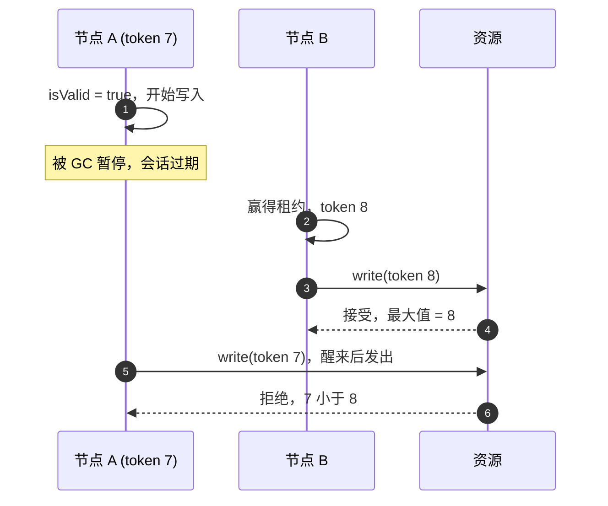

# Fencing 与故障

[Simba 如何工作](/zh/guide/concepts) 约束的是节点 *认为* 的东西：它的任期会在后端能把租约交给别人之前结束。本页讨论的是节点不再是持有者之后
仍可能 *做* 什么，以及当这件事绝不能产生影响时，你的代码必须做什么。

## 为什么有效的任期还不够 {#why-a-valid-term-is-not-enough}

写入前检查 `term.isValid` 能缩小过期写入的窗口，但无法消除它。进程可能刚检查完就被暂停：



只有资源能看到两次写入，所以只有资源能做出判断。它需要一个随每个新持有者增长、并且不受暂停影响的数字：任期的 **fencing token**。

## Fencing 协议 {#the-fencing-protocol}

1. 每次写入被保护的资源时都传入 `term.token`。
2. 资源只在 token **不小于** 它已接受的最大 token 时才接受写入，并记录该 token。相等的 token 必须被接受：同一任期内的重试携带相同的 token。
3. 检查与写入是 **一个原子步骤**。先读取最大 token、再写入，会让过期的持有者通过检查，并在较新的持有者之后完成写入。

### 示例 {#recipes}

**SQL**：一条条件 `UPDATE`；匹配零行表示过期的持有者。

```sql
-- once per resource: insert ignore into ledger_state (id) values (?);
update ledger_state
set last_batch = ?, fencing_token = ?
where id = ? and fencing_token <= ?;
```

MySQL Connector/J 默认报告匹配的行数，因此使用相同 token 和相同值的重试仍然计为 `1`。

**Redis**：一个 Lua 脚本；对于 Redis Cluster，把 token 和值放在同一个哈希槽（`{resource}`）中。

```lua
-- KEYS[1] = {resource}:token, KEYS[2] = {resource}:value, ARGV[1] = token, ARGV[2] = value
local highest = tonumber(redis.call('get', KEYS[1]) or '0')
if tonumber(ARGV[1]) < highest then
    return 0
end
redis.call('set', KEYS[1], ARGV[1])
redis.call('set', KEYS[2], ARGV[2])
return 1
```

**在单个 JVM 内**：在同一把锁下检查并写入。

```kotlin
synchronized(state) {
    if (fencingToken < state.highestToken) return false
    state.highestToken = fencingToken
    state.write(value)
    return true
}
```

### 验证你的资源 {#verify-your-resource}

`simba-tck` 提供 `FencingSpec`，这是一个让多个写入者并发争抢你的资源的 JUnit 测试套件；见
[测试](/zh/guide/testing#verifying-a-fencing-resource)。上面的示例都能通过它
（[`JdbcFencingRecipeTest`](https://github.com/Ahoo-Wang/Simba/blob/main/simba-jdbc/src/test/kotlin/me/ahoo/simba/jdbc/JdbcFencingRecipeTest.kt)、
[`RedisFencingRecipeTest`](https://github.com/Ahoo-Wang/Simba/blob/main/simba-redis/src/test/kotlin/me/ahoo/simba/redis/RedisFencingRecipeTest.kt)）。

## Token 从何而来 {#where-tokens-come-from}

Token 的单调性取决于为它计数的存储：

| 后端 | Token 来源 | 会回退吗？ |
|---|---|---|
| JDBC | `simba_lease.token`，每个任期 `+1`；行永不删除 | 只有数据库丢失已提交的数据时才会，例如切换到异步复制的副本 |
| Redis | `simba:lease:{name}` 的 `token` 字段，每个任期 `+1` | 会，在丢失最近写入的主从切换或键被淘汰之后：见 [token 回退](/zh/guide/backends#token-regression-after-a-failover) |
| Zookeeper | 租约节点的 `czxid`：严格递增但不连续 | 只有集群数据丢失或从较旧的快照恢复时才会 |

## 在每个步骤前检查 {#check-before-each-step}

除非任期在超过 `minRemaining` 的时间内仍然有效，否则 `term.ensureValid(minRemaining)` 抛出 `TermExpiredException`。
在任期即将结束时不应开始的步骤之前调用它：

```kotlin
simba.election("ledger").runWhileLeader { term ->
    for (batch in batches) {
        term.ensureValid(Duration.ofSeconds(2))   // expected duration of one batch
        ledger.settle(batch, fencingToken = term.token)
    }
}
```

这能防止持有者 *开始* 来不及完成的工作，但阻止不了检查 *之后* 的暂停，所以资源仍要检查 token。

## 选择保护方式 {#choosing-your-protection}

| 被保护的步骤是…… | 做法 |
|---|---|
| 写入一个能原子地比较数字的存储 | 用 `term.token` 做 fencing |
| 调用无法检查 token 的系统（邮件、支付 API） | 用从工作本身（而不是任期）派生的键使其幂等；fencing 在这里帮不上忙 |
| 重复执行只是浪费 | 依赖任期即可；在耗时步骤前检查 `ensureValid` |

任何故障转移之后，下一个 leader 都可能重做上一个 leader 的最后一步，因此无论选择哪种方式，幂等的工作运行起来都更省事。

## 故障模式 {#failure-modes}

| 场景 | 会发生什么 |
|---|---|
| Leader 进程崩溃 | 其会话在 `leaseDuration`（Zookeeper：会话超时）之后过期；候选者在下一次尝试时获取。 |
| Leader 正常停止 | 任务退出，租约被释放；Redis 和 Zookeeper 的候选者立即获取，JDBC 的候选者在下一次尝试时获取。 |
| 后端不可达 | 会话进入 `SUSPENDED`，续约按退避重试；到达本地截止时刻时，该节点的每个任期都被撤销（`DEADLINE_PASSED`），后端恢复响应后打开新会话。在此期间不会有任何东西继续以 leader 身份运行。 |
| 后端报告会话已过期 | 每个任期都被撤销（`SESSION_EXPIRED`），打开新会话，重新竞争。 |
| Leader 暂停时间超过租约（GC、虚拟机冻结） | 醒来时 `term.isValid` 已为 `false`；引擎撤销该任期。已经在途的写入仍可能落地：[fencing token](#the-fencing-protocol) 是唯一的防线。 |
| 续约显示租约被他人拥有 | 任期被撤销（`TAKEN_OVER`）。 |
| Zookeeper follower 与 leader 失联 | 在最多 `syncLimit` 个 tick 内，该 follower 仍会应答读请求，而 leader 已看不到这个会话并会让它过期。续约会先经 leader 执行 `sync`，因此在这样的 follower 上续约会失败，本地截止时刻随之耗尽，绝不会晚于 leader 对该会话的判定。 |
| 时钟速率差异超过 `drift` | 安全性论证不再成立；请调大 `drift`。 |
| Redis 主从切换丢失最近的写入 | Token 可能回退；见 [后端](/zh/guide/backends#token-regression-after-a-failover)。 |
| Redis 在内存压力下淘汰键（`allkeys-*` 策略） | 被淘汰的租约 hash 会让 token 从 1 重新开始，因此 token 回退；请使用 `noeviction` 或专用实例，见 [后端](/zh/guide/backends#memory-eviction)。 |
| 切换到异步复制的数据库副本（MySQL 从库、PostgreSQL 备库提升） | 与 Redis 主从切换相同：最近的 token 自增和续约可能丢失，因此 token 可能回退。需要 fencing 成立时请使用同步复制；见 [后端](/zh/guide/backends#jdbc-operating-notes)。 |
| 后端主机的时钟跳变（NTP step、虚拟机迁移） | JDBC 和 Redis 用该时钟测量租约，因此所有租约会同时缩短（向前跳）或延长（向后跳）。向前跳可能让持有者的租约在后端已过期，而它的本地截止时刻还没到：另一个节点可能赢得任期，旧持有者读到的 `isValid` 仍为真。这不是速率漂移，`drift` 无法覆盖；只有 fencing token 能防护。后端主机请使用平滑调整（slew）的时间同步。 |
