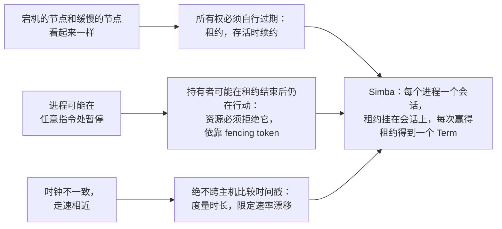

# 为什么选择 Simba

有些工作必须 **同一时刻只由一个节点** 完成：夜间报表、某个分区的消费者、驱动工作流的进程、为一张发票扣款的步骤。
在单个 JVM 内，一个 `synchronized` 块就能做到。跨进程时，这是另一个问题，而任何诚实的解决方案的形态，都由分布式系统的三个事实决定。
本页推导出这一形态；Simba 就是这一形态，以库的方式打包。

## 三个事实 {#three-facts}

**1. 宕机的节点和缓慢的节点看起来一样。** 当一个节点不再响应时，其他节点无法分辨它是崩溃了、卡在一次漫长的 GC 里，还是被网络隔离了。
没有任何消息能证明它已经不在了。

**2. 进程可能在任意一条指令处暂停。** 垃圾回收、虚拟机冻结、换出页面的缺页中断或磁盘卡顿，都可能让进程停顿数秒，
发生在你代码的任意两行之间，而进程自己毫无察觉。

**3. 时钟彼此不一致，但走速相近。** 不同主机上的挂钟相差未知的量，还可能跳变（NTP 步进、虚拟机迁移）。可靠的是：
每台主机的单调时钟度量流逝时间的速率，与其他主机相当接近。

## 它们迫使什么 {#what-they-force}

每个事实都排除了一种朴素设计，并迫使出一种机制：

- **等待持有者主动释放的锁是不安全的**：如果持有者已经宕机，它会永远等下去（事实 1）。因此所有权必须是 **租约**：
  只授予一段有限的时间，并且只有续约才能保有。节点无论因为什么原因停止续约，它的租约都会到期，另一个节点就可以接管。
- **单靠租约无法阻止暂停的持有者**（事实 2）。持有者检查“我的租约有效”，随即暂停，租约到期，另一个节点接管，
  然后第一个节点醒来并写入。持有者一侧的任何检查都无法弥补这个缺口，因为暂停可能恰好发生在检查之后。只有 **被写入的资源**
  才能拒绝过期的写入者，而它需要一个可比较的东西：一个随每个新所有者递增的 **fencing token**。
- **“有效期至 12:00:15”在另一台主机上毫无意义**（事实 3）。因此后端报告的是 *还剩* 多少时间，即用它自己的时钟度量的一段时长，
  每个节点再把它换算成自己单调时钟上的截止时刻，并扣除一份速率差的余量。这样，节点总是在后端可能把租约交给别人 *之前*
  就认为自己的租约已经结束。

这三种机制并非众多设计中的一种：每个正确的基于租约的方案都具备它们，而且在被保护资源不参与的情况下，没有方案能做得更好。
Simba 把它们实现一次，构建在你已经在运维的存储之上，无需 Simba 服务端。各部分如何组合，见 [Simba 如何工作](/zh/guide/concepts)。

## Simba 保证什么 {#what-simba-guarantees}

1. **在本地时钟所能判断的范围内，每个租约名称至多有一个有效任期。** 赢得租约的节点获得一个 *任期*。任期在会话的本地截止时刻之前有效，
   而只要节点与后端的时钟速率之差小于配置的 `drift`，这个时刻就总是早于后端把租约交给另一个会话的时刻。
   有效性在每次读取时根据单调时钟重新计算，因此一个从长时间暂停中醒来的进程在第一次读取时就会看到自己的任期已失效。
2. **Fencing token。** 每个任期都携带一个大于零的 token，在所有后端上，同一名称的 token 随任期严格递增。
3. **成对的回调。** 每个 `onElected(term)` 之后恰好跟随一个 `onRevoked(term, reason)`；同一选举的回调按顺序逐个执行，
   并且 `stop()` 完成之后不会再有回调到达。
4. **有序的交接。** `stop()` 和 `stepDown()` 会中断绑定在任期上的任务，等待其退出（最多等到任期的本地截止时刻），然后才释放租约。
5. **活性。** 关闭客户端的节点会立即释放其租约。崩溃或与后端失联的节点会停止续约其会话，会话在 `leaseDuration` 之后过期，
   其他节点接管它的租约。

## Simba 不能保证什么 {#what-simba-cannot-guarantee}

任期是后端状态的一个 **弱一致视图**。被 GC、磁盘卡顿或网络分区暂停的进程，可能在会话过期之后恢复，并仍然完成一次已经开始的写入，
而此时另一个节点持有更新的任期。任何基于租约的锁都无法单独阻止这种情况，因此 Simba 从不承诺“没有脑裂”。

如何应对，取决于重叠的代价：

| 如果两个所有者短暂重叠是…… | 那么 |
|---|---|
| **有害的**（钱被转了两次、数据被破坏） | 在每次写入时携带 `term.token`，并让资源拒绝低于其已接受的最大值的 token：[Fencing 与故障](/zh/guide/correctness) |
| **浪费的**（报表生成了两次） | 仅靠任期就足够了；尽可能让任务幂等 |

Simba 也不会在后端不可达时继续运行任何东西：一旦会话的本地截止时刻已过，该节点的每个任期都会被撤销。
一个无法触达的协调服务无法进行协调。

## 选择 API {#choose-an-api}

所有 API 都挂在每个进程一个的 `Simba` 客户端上，它拥有一个后端会话。

| 你想要…… | 使用 | 页面 |
|---|---|---|
| 在本节点担任 leader 期间运行一个代码块，失去领导权时中断 | `election.runWhileLeader { term -> }` | [Leader 任务](/zh/guide/leader-work#run-while-leader) |
| 周期性地运行一个任务，且只在一个节点上 | `election.schedule(...)` 或 `@SimbaScheduled` | [Leader 任务](/zh/guide/leader-work#schedules) |
| 把 N 个分区的工作分散到存活的节点上 | `simba.group(name, n)` 或 `@SimbaPartitioned` | [Leader 任务](/zh/guide/leader-work#partition-groups) |
| 自己响应获得和失去领导权 | `election.start(listener)` | [Leader 任务](/zh/guide/leader-work#elections) |
| 在某个步骤外持有一把锁，然后释放 | `simba.lock(name).acquire(timeout)` | [锁](/zh/guide/locks) |
| 查看本节点的会话和选举 | `simba.snapshot()`、Actuator `simba` | [可观测性](/zh/guide/observability) |

优先选择满足需求的最高层级：绑定到任期的任务（`runWhileLeader`、`schedule`、分区组）自动获得交接顺序，而裸监听器则把它留给你。

## 选择后端 {#choose-a-backend}

选择你已经在运维的那个。三者都通过同一套 [TCK](/zh/guide/testing#backend-tck)；区别在于时间在哪里度量，以及 token 有多持久。

| | JDBC (MySQL 8, PostgreSQL 14+) | Redis 7 | Zookeeper |
|---|---|---|---|
| 租约时间的度量者 | 数据库时钟 | Redis `TIME` | Zookeeper 会话超时 |
| Fencing token | 行内计数器，每个任期 `+1` | 哈希内计数器，每个任期 `+1` | 节点的 `czxid` |
| 正常停止后的接管 | 候选者的下一次尝试 | 立即（释放广播） | 立即（节点 watch） |
| 崩溃后的接管 | 约 `leaseDuration` | 约 `leaseDuration` | 约协商后的会话超时 |
| Token 能否在故障切换后保持 | 采用同步复制时可以 | 不保证（异步复制） | 可以（法定人数提交） |

如果 fencing 必须在后端故障切换后依然成立，优先选择 Zookeeper 或采用同步复制的 JDBC；细节和运维说明见 [后端](/zh/guide/backends)。

## 下一步 {#where-to-next}

1. [快速开始](/zh/guide/quick-start)：添加依赖并运行代码。
2. [Simba 如何工作](/zh/guide/concepts)：会话、截止时刻、任期和交接顺序。
3. [Fencing 与故障](/zh/guide/correctness)：在保护任何绝不能写两次的东西之前，请先阅读本页。
