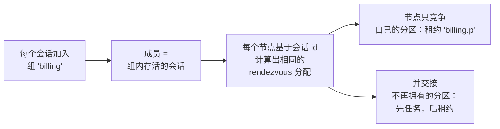

# 选举与 Leader 任务

**选举** 是租约的长期形式：节点竞争一个名称，能持有任期时就持有，每失去一个任期就重新竞争。但你通常想要的不是“知道我是 leader”，而是
“只在我是 leader 时运行这段代码”。因此 Simba 提供四个层次，每一层都建立在前一层之上：

| 层次 | API | 你得到的 |
|---|---|---|
| 监听 | `election.start(listener)` | `onElected` / `onRevoked`；任务的启动、停止和交接都由你负责 |
| 运行 | `election.runWhileLeader { term -> }` | 每个任期运行一个代码块，任期结束时被中断，并按顺序交接 |
| 调度 | `election.schedule(schedule) { term -> }` | 每个任期一个按固定延迟或固定速率运行的循环 |
| 分区 | `simba.group(name, n).schedule { term, partition -> }` | N 个选举，分散到存活的节点上 |

优先选择满足需求的最高层次。通过 Simba 启动的任务**绑定到一个任期**：它接收该 `Term`，只在该任期持续期间运行，并在任期结束时被中断。
它从不读取“当前的 leader 状态”，因此在一个任期中开始的运行永远不会拿到之后某个任期的 token，而且 `stop()` 会等它结束后再释放租约
（[交接顺序](/zh/guide/concepts#handover-order)）。

## 选举 {#elections}

```kotlin
val election = simba.election("order-dispatcher")
election.start(object : LeadershipListener {
    override fun onElected(term: Term) = dispatcher.start(term.token)
    override fun onRevoked(term: Term, reason: RevokeReason) = dispatcher.stop()
})
```

| 成员 | 行为 |
|---|---|
| `start(listener)` | 开始竞争；当该名称已在本客户端上启动时抛出 `IllegalStateException` |
| `stop()` | 停止竞争；`CompletionStage` 在最后一个 `onRevoked` 运行之后完成（未启动时立即完成） |
| `stepDown(cooldown)` | 放弃当前任期，并在 `cooldown` 内不参与竞争；选举保持启动状态 |

对同一名称调用 `simba.election(name)` 返回的句柄共享同一个选举。同一选举的回调逐个执行，必须保持简短；见
[回调与生命周期](/zh/guide/concepts#callbacks-and-lifecycle)。只用监听器时，释放租约前没有任何东西会等待你的任务，因此运行时间较长的任务请优先使用
`runWhileLeader`。

## 作为 Leader 运行 {#run-while-leader}

```kotlin
val task: LeaderTask = simba.election("ingest").runWhileLeader { term ->
    val cursor = cursors.load()
    while (term.isValid) {
        val batch = source.poll(cursor) ?: continue
        sink.write(batch, fencingToken = term.token)
    }
}
```

- 选举立即开始。该代码块在每个任期运行一次，每次都在客户端任务执行器的一个新虚拟线程上运行（或在作为第一个参数传入的
  `Executor` 上运行）。
- 任期被撤销时，其线程被中断，`term.revoked` 完成。编写代码块时，应让它在被中断或 `term.isValid` 变为 `false` 时停止。
- 提前返回的代码块会保持任期直到任期结束；在下一个任期之前该代码块不会再次运行。
- 异常会被记录日志，并以结果 `FAILED`（任期已结束时为 `CANCELLED`）发布为 `SimbaEvent.WorkCompleted`；它们从不影响选举。
  例外是 `VirtualMachineError`（内存溢出、栈溢出）：它会结束该任期的任务，选举让出一个租期，并把错误重新抛给任务线程。
- `task.stop()` 停止选举，并在当前任务退出（或用完时间）且租约已释放后完成；`task.close()` 做同样的事并等待。

当该选举已在本客户端上启动时，`runWhileLeader` 和 `schedule` 抛出 `IllegalStateException`。

## 调度 {#schedules}

`schedule` 是 `runWhileLeader` 加一个循环：每个任期一个循环，运行在一个虚拟线程上，每次运行前调用 `term.ensureValid()`。

```kotlin
simba.election("report").schedule(
    Schedule.fixedRate(Duration.ofMinutes(1)).withInitialDelay(Duration.ofSeconds(10))
) { term ->
    reportService.generate(fencingToken = term.token)
}
```

| 工厂方法 | 周期的度量方式 |
|---|---|
| `Schedule.fixedDelay(delay, initialDelay = 0)` | 从一次运行结束到下一次运行开始 |
| `Schedule.fixedRate(period, initialDelay = 0)` | 相邻两次计划开始之间；超时的运行会跳过错过的开始，而不是集中补跑 |

`initialDelay` 从每个任期开始时计算，周期必须为正。失败的运行（包括抛出 `Error`）会被记录并发布，循环继续；`VirtualMachineError`
会结束循环并让选举让出一个租期。循环随其任期结束。每个调度没有自己的线程池。

## 分区组 {#partition-groups}

有些任务可以拆成相互独立的分片，你希望每个存活节点都承担一部分，且每个分片在任一时刻只在一个节点上运行。分区组把 `partitions`
个分区分散到组内存活的节点上：

```kotlin
val task: GroupTask = simba.group("billing", partitions = 16)
    .schedule(Schedule.fixedDelay(Duration.ofMinutes(1))) { term, partition ->
        billing.run(shard = partition, fencingToken = term.token)
    }

task.partitions()   // partitions this node runs in its latest view
```

它由你已经熟悉的部件构成：



1. **成员关系就是会话。** 客户端的会话在后端加入该组，因此成员关系不需要自己的心跳，并随会话一起消失。
2. **分配是计算出来的，而不是协商出来的。** 每个节点都用 rendezvous hashing（`PartitionAssignment`，基于会话 id）从成员列表推导出相同的分配，
   因此节点加入或离开只会移动它得到或失去的分区。
3. **每个分区都是租约 `"{group}.{p}"` 上的一个普通选举。** 节点只竞争分配给它的分区，并按通常的[交接顺序](/zh/guide/concepts#handover-order)交出其他分区。
4. 成员视图在后端的成员变化提示（Zookeeper）时以及每个续约周期刷新。

变化期间各节点对成员列表的看法可能不一致，两个节点可能都想要同一个分区，但租约仍然保证至多一个节点持有有效任期：分配只决定谁去 *竞争*。
每个成员必须使用相同的 `partitions`。组名遵循租约名规则，且 `"{group}.{partitions - 1}"` 必须不超过 128 个字符。

也可以使用 `runWhileLeader { term, partition -> }`。`GroupTask.stop()` 离开组并停止每个分区，在每个分区都完成交接后完成，
包括之前的视图移走、仍在交接中的分区。

## Spring 注解 {#spring-annotations}

### `@SimbaScheduled` {#simbascheduled}

```java
@Service
public class ReportJobs {
    @SimbaScheduled(name = "report", fixedDelay = "1m", initialDelay = "10s")
    public void generate(Term term) {
        reportService.generate(term.getToken());
    }
}
```

| 属性 | 说明 |
|---|---|
| `name` | 由其 leader 运行该方法的选举（租约名）；在应用内唯一 |
| `fixedDelay` | 从一次运行结束到下一次运行开始的延迟 |
| `fixedRate` | 相邻两次运行开始之间的周期 |
| `initialDelay` | 每个任期第一次运行前的延迟（默认 `0s`） |

`fixedDelay` 和 `fixedRate` 必须恰好设置一个。方法不带参数，或只带一个 `Term` 参数。

### `@SimbaPartitioned` {#simbapartitioned}

```java
@Service
public class Billing {
    @SimbaPartitioned(group = "billing", partitions = 16, fixedDelay = "1m")
    public void bill(Term term, int partition) {
        billing.run(partition, term.getToken());
    }
}
```

| 属性 | 说明 |
|---|---|
| `group` | 组名，在应用内唯一；分区 `p` 以 `"{group}.{p}"` 进行选举 |
| `partitions` | 分区数量；每个成员必须使用相同的值 |
| `fixedDelay` / `fixedRate` / `initialDelay` | 与 `@SimbaScheduled` 相同，按分区生效 |

方法参数为 `(Term, int)`。

两个注解的字符串属性都支持 `${...}` 占位符，时长使用 Spring Boot 格式（`10s`、`500ms`、`PT1M`）。两个注解选举的租约名和组共享同一个命名空间：
出现冲突时启动失败。方法在上下文刷新后启动，并在关闭时、客户端关闭之前停止（见[关闭顺序](/zh/guide/configuration#shutdown-order)）；
用 `simba.scheduling.enabled=false` 禁用它们。

## 编写良好的 Leader 任务 {#writing-good-leader-work}

- **把 `term.token` 传给任务对共享资源的每一次写入**。暂停的节点在其任期结束后仍可能写入成功；只有校验
  [fencing token](/zh/guide/correctness#the-fencing-protocol) 的资源才能拒绝它。
- **在被中断时停止。** 忽略中断的阻塞 I/O 会把交接最多推迟到任期的剩余时间。
- **在耗时步骤之前检查：** `term.ensureValid(expectedStepDuration)` 会抛出 `TermExpiredException`，而不是开始一个会超出任期的步骤。
- 尽可能**让任务幂等**：故障转移之后，下一个 leader 可能会重做最后一个步骤。
